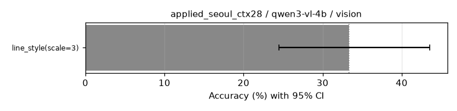
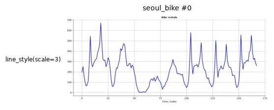

# 실험 보고서: applied_seoul_context

같은 따릉이 90문항·같은 정답으로, 보여주는 이력만 7일 / 14일 / 28일로 바꾼다. text(숫자 나열)와 vision(line_style scale 3)의 입력 토큰·응답 시간·context 초과·정확도를 비교한다. 핵심 지표는 prompt_tokens 와 latency. 정확도는 참고. 출력은 짧은 JSON만 요청하고 max_tokens 256 (긴 CoT 시 시간 비교 불가). 모델 qwen3-vl-4b, sampling official.

- 생성: 2026-11-26T05:35:41+00:00
- 진행: 540 / 540 요청 완료 (100.0%)
- 대상: applied_seoul_ctx7, applied_seoul_ctx14, applied_seoul_ctx28 | 모델: qwen3-vl-4b | 입력: text, vision
- sampling: `official`, repeats 1, max_tokens 256, text 값 간격 1
- 비교 기준(baseline): `line_style(scale=3)`

읽는 법

- 정확도: 처리가 끝난 문항 중 정답 비율. 답 글자를 못 뽑은 응답과 context 초과 문항은 오답으로 친다. 대괄호는 95% 신뢰구간.
- 공식 방식: TSRBench 공식 채점처럼 JSON 으로 읽히지 않은 응답을 분모에서 뺀 값.
- 차이: 같은 문항끼리 baseline 과 비교한 값(%p). 얻음/잃음 = baseline 에서 틀렸다가 맞은 / 맞았다가 틀린 문항 수.
- p: McNemar exact test. p(Holm) 은 같은 표 안의 여러 비교를 보정한 값이다.
- 토큰·시간: 입력/출력 tok 은 문항당 평균과 cell 합. 응답 s 는 문항당 중앙값과 cell 합(병렬 전 wall time 아님).

## 토큰·소요시간 요약

문항당 평균 입력 토큰·응답 시간(중앙값)과, 해당 cell 전체 합. lookback 이 길어질수록 text 입력이 커지는지, vision 은 유지되는지 본다.

| benchmark | model | 입력 | chart | 입력 tok (평균) | 입력 tok (합) | 출력 tok (평균) | 출력 tok (합) | 응답 s (중앙값) | 응답 s (합) | 정확도 % | context 초과 |
| --- | --- | --- | --- | --- | --- | --- | --- | --- | --- | --- | --- |
| applied_seoul_ctx14 | qwen3-vl-4b | text | none | 2020 | 311267 | 171 | 29301 | 2.0 | 292 | 26.7 | 0 |
| applied_seoul_ctx14 | qwen3-vl-4b | vision | line_style(scale=3) | 994 | 92441 | 85 | 8139 | 0.8 | 91 | 22.2 | 0 |
| applied_seoul_ctx28 | qwen3-vl-4b | text | none | 3736 | 552452 | 167 | 27542 | 2.9 | 369 | 23.3 | 0 |
| applied_seoul_ctx28 | qwen3-vl-4b | vision | line_style(scale=3) | 994 | 92438 | 85 | 8114 | 0.9 | 91 | 33.3 | 0 |
| applied_seoul_ctx7 | qwen3-vl-4b | text | none | 1168 | 141002 | 141 | 18955 | 1.3 | 174 | 35.6 | 0 |
| applied_seoul_ctx7 | qwen3-vl-4b | vision | line_style(scale=3) | 993 | 90353 | 98 | 9018 | 0.8 | 93 | 20.0 | 0 |

## applied_seoul_ctx7 / qwen3-vl-4b / vision

| chart | 문항 수 | 정확도 % [95% CI] | 차이 %p [95% CI] | 얻음 / 잃음 | p | p (Holm) | 공식 방식 % | 답 없음 | 처리율 |
| --- | --- | --- | --- | --- | --- | --- | --- | --- | --- |
| **line_style(scale=3)** (baseline) | 90 | 20.0 [13.0, 29.4] |  |  |  |  | 20.0 | 0 | 100% |

기준선: 최빈 정답(C)만 찍으면 38.9% / 직전 24시간과 같다(C)고 하면 38.9% / 7일 전 같은 요일 수준을 고르면 34.4% / text 만 입력(chart 없음) 35.6% [26.4, 45.9], 90문항 / text 대비 vision(line_style(scale=3)) -15.6%p (text 틀림·이 조건 맞음 12 / text 맞음·이 조건 틀림 26, p 0.034)

### 비용과 입력 크기

| chart | 입력 tok (평균) | 입력 tok (합) | 출력 tok (평균) | 출력 tok (합) | 응답 s (중앙값) | 응답 s (합) | 이미지 수 | 이미지 px (최빈) | 이미지 KB | 재요청 | 길이 한도로 잘림 | 오류 | context 초과 |
| --- | --- | --- | --- | --- | --- | --- | --- | --- | --- | --- | --- | --- | --- |
| line_style(scale=3) | 993 | 90353 | 98 | 9018 | 0.8 | 93 | 1.0 | 1239x544 | 62 | 1 | 0 | 0 | 0 |

## applied_seoul_ctx14 / qwen3-vl-4b / vision

| chart | 문항 수 | 정확도 % [95% CI] | 차이 %p [95% CI] | 얻음 / 잃음 | p | p (Holm) | 공식 방식 % | 답 없음 | 처리율 |
| --- | --- | --- | --- | --- | --- | --- | --- | --- | --- |
| **line_style(scale=3)** (baseline) | 90 | 22.2 [14.9, 31.8] |  |  |  |  | 22.2 | 0 | 100% |

기준선: 최빈 정답(C)만 찍으면 38.9% / 직전 24시간과 같다(C)고 하면 38.9% / 7일 전 같은 요일 수준을 고르면 34.4% / text 만 입력(chart 없음) 26.7% [18.6, 36.6], 90문항 / text 대비 vision(line_style(scale=3)) -4.4%p (text 틀림·이 조건 맞음 10 / text 맞음·이 조건 틀림 14, p 0.541)

### 비용과 입력 크기

| chart | 입력 tok (평균) | 입력 tok (합) | 출력 tok (평균) | 출력 tok (합) | 응답 s (중앙값) | 응답 s (합) | 이미지 수 | 이미지 px (최빈) | 이미지 KB | 재요청 | 길이 한도로 잘림 | 오류 | context 초과 |
| --- | --- | --- | --- | --- | --- | --- | --- | --- | --- | --- | --- | --- | --- |
| line_style(scale=3) | 994 | 92441 | 85 | 8139 | 0.8 | 91 | 1.0 | 1236x544 | 74 | 3 | 0 | 0 | 0 |

## applied_seoul_ctx28 / qwen3-vl-4b / vision

| chart | 문항 수 | 정확도 % [95% CI] | 차이 %p [95% CI] | 얻음 / 잃음 | p | p (Holm) | 공식 방식 % | 답 없음 | 처리율 |
| --- | --- | --- | --- | --- | --- | --- | --- | --- | --- |
| **line_style(scale=3)** (baseline) | 90 | 33.3 [24.5, 43.6] |  |  |  |  | 33.3 | 0 | 100% |

기준선: 최빈 정답(C)만 찍으면 38.9% / 직전 24시간과 같다(C)고 하면 38.9% / 7일 전 같은 요일 수준을 고르면 34.4% / text 만 입력(chart 없음) 23.3% [15.8, 33.1], 90문항 / text 대비 vision(line_style(scale=3)) +10.0%p (text 틀림·이 조건 맞음 21 / text 맞음·이 조건 틀림 12, p 0.163)

### 비용과 입력 크기

| chart | 입력 tok (평균) | 입력 tok (합) | 출력 tok (평균) | 출력 tok (합) | 응답 s (중앙값) | 응답 s (합) | 이미지 수 | 이미지 px (최빈) | 이미지 KB | 재요청 | 길이 한도로 잘림 | 오류 | context 초과 |
| --- | --- | --- | --- | --- | --- | --- | --- | --- | --- | --- | --- | --- | --- |
| line_style(scale=3) | 994 | 92438 | 85 | 8114 | 0.9 | 91 | 1.0 | 1234x544 | 89 | 3 | 0 | 0 | 0 |

## applied_seoul_ctx7 / qwen3-vl-4b / text (chart 없음)

| 문항 수 | 정확도 % [95% CI] | 공식 방식 % | 답 없음 | context 초과 | 처리율 |
| --- | --- | --- | --- | --- | --- |
| 90 | 35.6 [26.4, 45.9] | 35.6 | 0 | 0 | 100% |

기준선: 최빈 정답(C)만 찍으면 38.9% / 직전 24시간과 같다(C)고 하면 38.9% / 7일 전 같은 요일 수준을 고르면 34.4%

### 비용과 입력 크기

| 입력 tok (평균) | 입력 tok (합) | 출력 tok (평균) | 출력 tok (합) | 응답 s (중앙값) | 응답 s (합) | 재요청 | 길이 한도로 잘림 | 오류 | context 초과 |
| --- | --- | --- | --- | --- | --- | --- | --- | --- | --- |
| 1168 | 141002 | 141 | 18955 | 1.3 | 174 | 25 | 0 | 0 | 0 |

## applied_seoul_ctx14 / qwen3-vl-4b / text (chart 없음)

| 문항 수 | 정확도 % [95% CI] | 공식 방식 % | 답 없음 | context 초과 | 처리율 |
| --- | --- | --- | --- | --- | --- |
| 90 | 26.7 [18.6, 36.6] | 26.7 | 0 | 0 | 100% |

기준선: 최빈 정답(C)만 찍으면 38.9% / 직전 24시간과 같다(C)고 하면 38.9% / 7일 전 같은 요일 수준을 고르면 34.4%

### 비용과 입력 크기

| 입력 tok (평균) | 입력 tok (합) | 출력 tok (평균) | 출력 tok (합) | 응답 s (중앙값) | 응답 s (합) | 재요청 | 길이 한도로 잘림 | 오류 | context 초과 |
| --- | --- | --- | --- | --- | --- | --- | --- | --- | --- |
| 2020 | 311267 | 171 | 29301 | 2.0 | 292 | 34 | 0 | 0 | 0 |

## applied_seoul_ctx28 / qwen3-vl-4b / text (chart 없음)

| 문항 수 | 정확도 % [95% CI] | 공식 방식 % | 답 없음 | context 초과 | 처리율 |
| --- | --- | --- | --- | --- | --- |
| 90 | 23.3 [15.8, 33.1] | 23.3 | 0 | 0 | 100% |

기준선: 최빈 정답(C)만 찍으면 38.9% / 직전 24시간과 같다(C)고 하면 38.9% / 7일 전 같은 요일 수준을 고르면 34.4%

### 비용과 입력 크기

| 입력 tok (평균) | 입력 tok (합) | 출력 tok (평균) | 출력 tok (합) | 응답 s (중앙값) | 응답 s (합) | 재요청 | 길이 한도로 잘림 | 오류 | context 초과 |
| --- | --- | --- | --- | --- | --- | --- | --- | --- | --- |
| 3736 | 552452 | 167 | 27542 | 2.9 | 369 | 36 | 0 | 0 | 0 |

## chart 예시

같은 문항을 chart 별로 그린 것 (행 = chart, 열 = 문항).

### seoul_bike

## 실행 환경과 설정

| model | 이름 | 서빙 설정 | 보낸 sampling | 서버 기본 sampling |
| --- | --- | --- | --- | --- |
| qwen3-vl-4b | Qwen/Qwen3-VL-4B-Instruct | dtype=float16, limit_mm_per_prompt={'image': 4}, revision=ebb281ec70b05090aa6165b016eac8ec08e71b17 | 없음 (서버 기본값 사용) | {'do_sample': True, 'temperature': 0.7, 'top_p': 0.8, 'top_k': 20, 'repetition_penalty': 1.0} |

- OS Linux 6.8.0-149-generic, Python 3.12.16, CPU Intel(R) Core(TM) Ultra 7 270K Plus (24 threads), RAM 62.1 GB
- GPU: NVIDIA GeForce RTX 5090 32GB | Colab: 아니오
- 패키지: matplotlib 3.11.2, pillow 13.0.0, numpy 2.5.4, openai 3.49.0, huggingface_hub 2.4.0, PyYAML 6.0.3, rich 15.0.0, torch 2.15.0+cu132
- git commit: a1395e98 (커밋 안 된 수정 있음)

run 폴더 (raw 결과)

- `runs/applied_seoul_ctx7/seoul_bike/qwen3-vl-4b/text/none__8626e6a7` : applied_seoul_ctx7/seoul_bike | qwen3-vl-4b | text | none
- `runs/applied_seoul_ctx7/seoul_bike/qwen3-vl-4b/vision/line_style-scale3__ec7fb01c` : applied_seoul_ctx7/seoul_bike | qwen3-vl-4b | vision | line_style(scale=3)
- `runs/applied_seoul_ctx14/seoul_bike/qwen3-vl-4b/text/none__73f9be64` : applied_seoul_ctx14/seoul_bike | qwen3-vl-4b | text | none
- `runs/applied_seoul_ctx14/seoul_bike/qwen3-vl-4b/vision/line_style-scale3__4080c735` : applied_seoul_ctx14/seoul_bike | qwen3-vl-4b | vision | line_style(scale=3)
- `runs/applied_seoul_ctx28/seoul_bike/qwen3-vl-4b/text/none__08ff0557` : applied_seoul_ctx28/seoul_bike | qwen3-vl-4b | text | none
- `runs/applied_seoul_ctx28/seoul_bike/qwen3-vl-4b/vision/line_style-scale3__14cd7466` : applied_seoul_ctx28/seoul_bike | qwen3-vl-4b | vision | line_style(scale=3)

