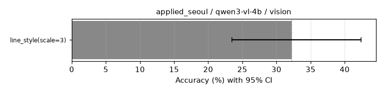
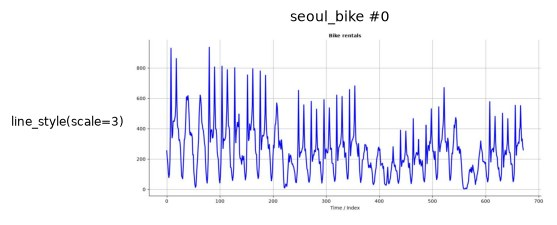

# 실험 보고서: applied_seoul_forecast_lab

서울 공공자전거만. 직전 4주(672시간)로 다음 24시간 평균의 다섯 단계. 차트는 line_style scale 3. 90문항. text, vision, text+vision 을 같은 문항으로 비교한다. 모델은 기본 qwen3-vl-4b. 대형 VLM 은 --models 로 바꾸거나 models.yaml 에 추가한다.

- 생성: 2026-11-25T10:17:17+00:00
- 진행: 90 / 270 요청 완료 (33.3%) - **미완료 상태의 중간 결과**
- 대상: applied_seoul | 모델: qwen3-vl-4b | 입력: text, vision, text+vision
- sampling: `official`, repeats 1, max_tokens 없음(공식), text 값 간격 1
- 비교 기준(baseline): `line_style(scale=3)`

읽는 법

- 정확도: 처리가 끝난 문항 중 정답 비율. 답 글자를 못 뽑은 응답과 context 초과 문항은 오답으로 친다. 대괄호는 95% 신뢰구간.
- 공식 방식: TSRBench 공식 채점처럼 JSON 으로 읽히지 않은 응답을 분모에서 뺀 값.
- 차이: 같은 문항끼리 baseline 과 비교한 값(%p). 얻음/잃음 = baseline 에서 틀렸다가 맞은 / 맞았다가 틀린 문항 수.
- p: McNemar exact test. p(Holm) 은 같은 표 안의 여러 비교를 보정한 값이다.

## applied_seoul / qwen3-vl-4b / vision

| chart | 문항 수 | 정확도 % [95% CI] | 차이 %p [95% CI] | 얻음 / 잃음 | p | p (Holm) | 공식 방식 % | 답 없음 | 처리율 |
| --- | --- | --- | --- | --- | --- | --- | --- | --- | --- |
| **line_style(scale=3)** (baseline) | 90 | 32.2 [23.5, 42.4] |  |  |  |  | 32.2 | 0 | 100% |

기준선: 최빈 정답(C)만 찍으면 38.9% / 직전 24시간과 같다(C)고 하면 38.9% / 7일 전 같은 요일 수준을 고르면 34.4%

### 비용과 입력 크기

| chart | 입력 tok | 출력 tok | 응답 시간 s (중앙값) | 이미지 수 | 이미지 px (최빈) | 이미지 KB | 재요청 | 길이 한도로 잘림 | 오류 | context 초과 |
| --- | --- | --- | --- | --- | --- | --- | --- | --- | --- | --- |
| line_style(scale=3) | 969 | 1820 | 5.1 | 1.0 | 1234x544 | 89 | 30 | 0 | 0 | 0 |

## applied_seoul / qwen3-vl-4b / text+vision

| chart | 문항 수 | 정확도 % [95% CI] | 차이 %p [95% CI] | 얻음 / 잃음 | p | p (Holm) | 공식 방식 % | 답 없음 | 처리율 |
| --- | --- | --- | --- | --- | --- | --- | --- | --- | --- |
| **line_style(scale=3)** (baseline) | 0 | -  |  |  |  |  | - | 0 | 0% |

기준선: 최빈 정답(C)만 찍으면 38.9% / 직전 24시간과 같다(C)고 하면 38.9% / 7일 전 같은 요일 수준을 고르면 34.4%

### 비용과 입력 크기

| chart | 입력 tok | 출력 tok | 응답 시간 s (중앙값) | 이미지 수 | 이미지 px (최빈) | 이미지 KB | 재요청 | 길이 한도로 잘림 | 오류 | context 초과 |
| --- | --- | --- | --- | --- | --- | --- | --- | --- | --- | --- |
| line_style(scale=3) | - | - | - | - | - | - | 0 | 0 | 0 | 0 |

## applied_seoul / qwen3-vl-4b / text (chart 없음)

| 문항 수 | 정확도 % [95% CI] | 공식 방식 % | 답 없음 | context 초과 | 처리율 |
| --- | --- | --- | --- | --- | --- |
| 0 | -  | - | 0 | 0 | 0% |

기준선: 최빈 정답(C)만 찍으면 38.9% / 직전 24시간과 같다(C)고 하면 38.9% / 7일 전 같은 요일 수준을 고르면 34.4%

## chart 예시

같은 문항을 chart 별로 그린 것 (행 = chart, 열 = 문항).

### seoul_bike

## 실행 환경과 설정

| model | 이름 | 서빙 설정 | 보낸 sampling | 서버 기본 sampling |
| --- | --- | --- | --- | --- |
| qwen3-vl-4b | Qwen/Qwen3-VL-4B-Instruct | dtype=float16, limit_mm_per_prompt={'image': 4}, revision=ebb281ec70b05090aa6165b016eac8ec08e71b17 | 없음 (서버 기본값 사용) | {'do_sample': True, 'temperature': 0.7, 'top_p': 0.8, 'top_k': 20, 'repetition_penalty': 1.0} |

- OS Linux 6.8.0-149-generic, Python 3.12.16, CPU Intel(R) Core(TM) Ultra 7 270K Plus (24 threads), RAM 62.1 GB
- GPU: NVIDIA GeForce RTX 5090 32GB | Colab: 아니오
- 패키지: matplotlib 3.11.2, pillow 13.0.0, numpy 2.5.4, openai 3.49.0, huggingface_hub 2.4.0, PyYAML 6.0.3, rich 15.0.0, torch 2.15.0+cu132
- git commit: 25b4e8b3 (커밋 안 된 수정 있음)

run 폴더 (raw 결과)

- `runs/applied_seoul/seoul_bike/qwen3-vl-4b/vision/line_style-scale3__e1e1811a` : applied_seoul/seoul_bike | qwen3-vl-4b | vision | line_style(scale=3)

