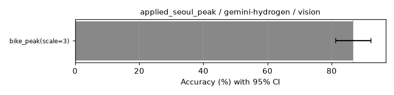
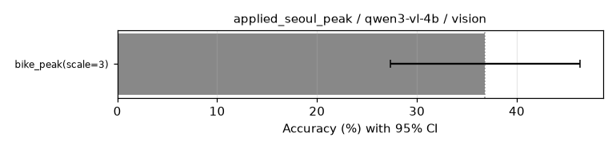
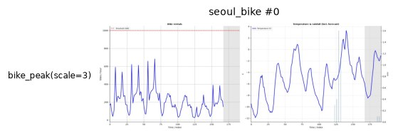

# 실험 보고서: applied_seoul_peak_lab

서울 공공자전거 7일 대여량과 내일 기상예보로, 내일 시간당 1000대 이상인 시각을 모두 배열로 고른다. 차트는 bike_peak scale 3 (대여량|기상 가로 배치). 전환일 우선 60문항. 채점은 집합 F1. text, vision, text+vision 을 같은 문항으로 비교한다. 모델은 기본 qwen3-vl-4b. 대형 VLM 은 --models 로 바꾸거나 models.yaml 에 추가한다.

- 생성: 2026-11-25T10:17:17+00:00
- 진행: 180 / 240 요청 완료 (75.0%) - **미완료 상태의 중간 결과**
- 대상: applied_seoul_peak | 모델: gemini-hydrogen, qwen3-vl-4b | 입력: text, vision
- sampling: `official`, repeats 1, max_tokens 없음(공식), text 값 간격 1
- 비교 기준(baseline): `bike_peak(scale=3)`

읽는 법

- 정확도: 처리가 끝난 문항 중 정답 비율. 답 글자를 못 뽑은 응답과 context 초과 문항은 오답으로 친다. 대괄호는 95% 신뢰구간.
- 공식 방식: TSRBench 공식 채점처럼 JSON 으로 읽히지 않은 응답을 분모에서 뺀 값.
- 차이: 같은 문항끼리 baseline 과 비교한 값(%p). 얻음/잃음 = baseline 에서 틀렸다가 맞은 / 맞았다가 틀린 문항 수.
- p: McNemar exact test. p(Holm) 은 같은 표 안의 여러 비교를 보정한 값이다.

## applied_seoul_peak / gemini-hydrogen / vision

| chart | 문항 수 | 정확도 % [95% CI] | 차이 %p [95% CI] | 얻음 / 잃음 | p | p (Holm) | 공식 방식 % | 답 없음 | 처리율 |
| --- | --- | --- | --- | --- | --- | --- | --- | --- | --- |
| **bike_peak(scale=3)** (baseline) | 60 | 86.8 [81.3, 92.2] |  |  |  |  | 86.8 | 0 | 100% |

기준선: 어제 95% 피크 시간을 그대로 쓰면 69.4% / 7일 전 95% 피크 시간을 그대로 쓰면 65.9% / 무조건 16시면 6.7% / text 만 입력(chart 없음) 87.9% [82.5, 93.4], 60문항 / text 대비 vision(bike_peak(scale=3)) -1.7%p (text 틀림·이 조건 맞음 6 / text 맞음·이 조건 틀림 7, p 1.000)

### 비용과 입력 크기

| chart | 입력 tok | 출력 tok | 응답 시간 s (중앙값) | 이미지 수 | 이미지 px (최빈) | 이미지 KB | 재요청 | 길이 한도로 잘림 | 오류 | context 초과 |
| --- | --- | --- | --- | --- | --- | --- | --- | --- | --- | --- |
| bike_peak(scale=3) | 1694 | 297 | 58.4 | 1.0 | 1910x710 | 126 | 0 | 0 | 0 | 0 |

## applied_seoul_peak / qwen3-vl-4b / vision

| chart | 문항 수 | 정확도 % [95% CI] | 차이 %p [95% CI] | 얻음 / 잃음 | p | p (Holm) | 공식 방식 % | 답 없음 | 처리율 |
| --- | --- | --- | --- | --- | --- | --- | --- | --- | --- |
| **bike_peak(scale=3)** (baseline) | 60 | 36.8 [27.3, 46.3] |  |  |  |  | 36.8 | 0 | 100% |

기준선: 어제 95% 피크 시간을 그대로 쓰면 69.4% / 7일 전 95% 피크 시간을 그대로 쓰면 65.9% / 무조건 16시면 6.7%

### 비용과 입력 크기

| chart | 입력 tok | 출력 tok | 응답 시간 s (중앙값) | 이미지 수 | 이미지 px (최빈) | 이미지 KB | 재요청 | 길이 한도로 잘림 | 오류 | context 초과 |
| --- | --- | --- | --- | --- | --- | --- | --- | --- | --- | --- |
| bike_peak(scale=3) | 1550 | 7265 | 15.1 | 1.0 | 1910x710 | 126 | 25 | 0 | 0 | 0 |

## applied_seoul_peak / gemini-hydrogen / text (chart 없음)

| 문항 수 | 정확도 % [95% CI] | 공식 방식 % | 답 없음 | context 초과 | 처리율 |
| --- | --- | --- | --- | --- | --- |
| 60 | 87.9 [82.5, 93.4] | 87.9 | 0 | 0 | 100% |

기준선: 어제 95% 피크 시간을 그대로 쓰면 69.4% / 7일 전 95% 피크 시간을 그대로 쓰면 65.9% / 무조건 16시면 6.7%

## applied_seoul_peak / qwen3-vl-4b / text (chart 없음)

| 문항 수 | 정확도 % [95% CI] | 공식 방식 % | 답 없음 | context 초과 | 처리율 |
| --- | --- | --- | --- | --- | --- |
| 0 | -  | - | 0 | 0 | 0% |

기준선: 어제 95% 피크 시간을 그대로 쓰면 69.4% / 7일 전 95% 피크 시간을 그대로 쓰면 65.9% / 무조건 16시면 6.7%

## chart 예시

같은 문항을 chart 별로 그린 것 (행 = chart, 열 = 문항).

### seoul_bike

## 실행 환경과 설정

| model | 이름 | 서빙 설정 | 보낸 sampling | 서버 기본 sampling |
| --- | --- | --- | --- | --- |
| gemini-hydrogen | gemini-4-hydrogen | 설정 미상 (외부 endpoint) | 없음 (서버 기본값 사용) | - |
| qwen3-vl-4b | Qwen/Qwen3-VL-4B-Instruct | dtype=float16, limit_mm_per_prompt={'image': 4}, revision=ebb281ec70b05090aa6165b016eac8ec08e71b17 | 없음 (서버 기본값 사용) | {'do_sample': True, 'temperature': 0.7, 'top_p': 0.8, 'top_k': 20, 'repetition_penalty': 1.0} |

- OS Linux 6.8.0-149-generic, Python 3.12.16, CPU Intel(R) Core(TM) Ultra 7 270K Plus (24 threads), RAM 62.1 GB
- GPU: NVIDIA GeForce RTX 5090 32GB | Colab: 아니오
- 패키지: matplotlib 3.11.2, pillow 13.0.0, numpy 2.5.4, openai 3.49.0, huggingface_hub 2.4.0, PyYAML 6.0.3, rich 15.0.0, torch 2.15.0+cu132
- git commit: 25b4e8b3 (커밋 안 된 수정 있음)

run 폴더 (raw 결과)

- `runs/applied_seoul_peak/seoul_bike/gemini-hydrogen/text/none__3d588a63` : applied_seoul_peak/seoul_bike | gemini-hydrogen | text | none
- `runs/applied_seoul_peak/seoul_bike/gemini-hydrogen/vision/bike_peak-scale3__3ad3713c` : applied_seoul_peak/seoul_bike | gemini-hydrogen | vision | bike_peak(scale=3)
- `runs/applied_seoul_peak/seoul_bike/qwen3-vl-4b/vision/bike_peak-scale3__90f3b5d7` : applied_seoul_peak/seoul_bike | qwen3-vl-4b | vision | bike_peak(scale=3)

