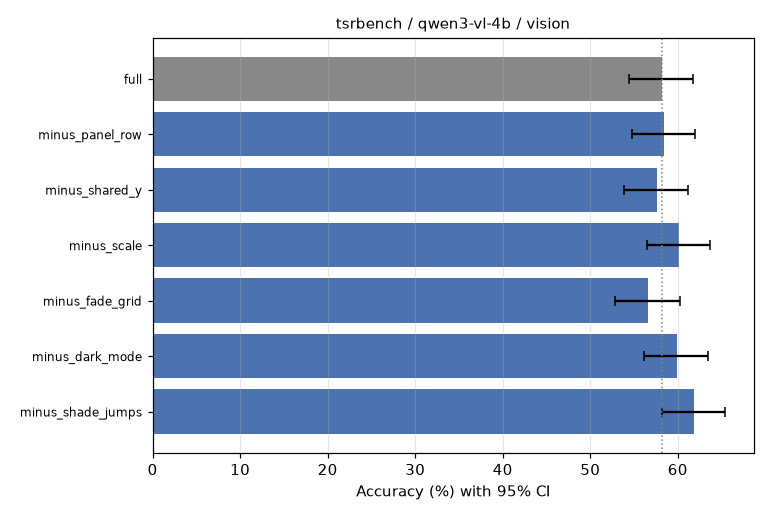
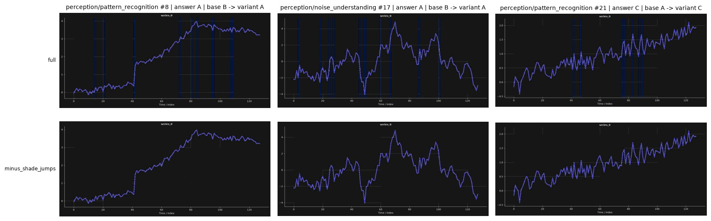
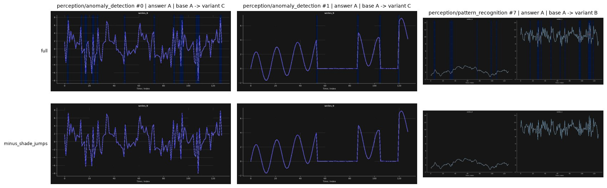
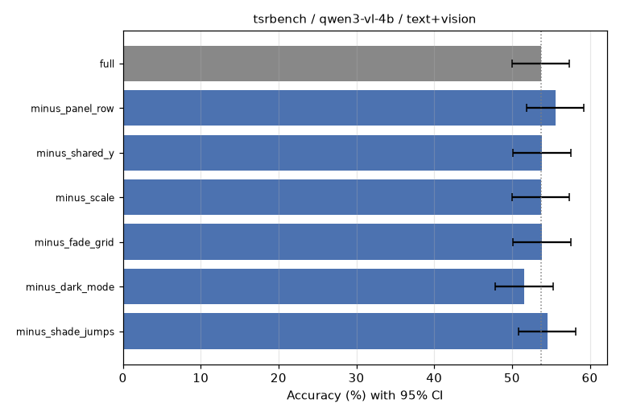
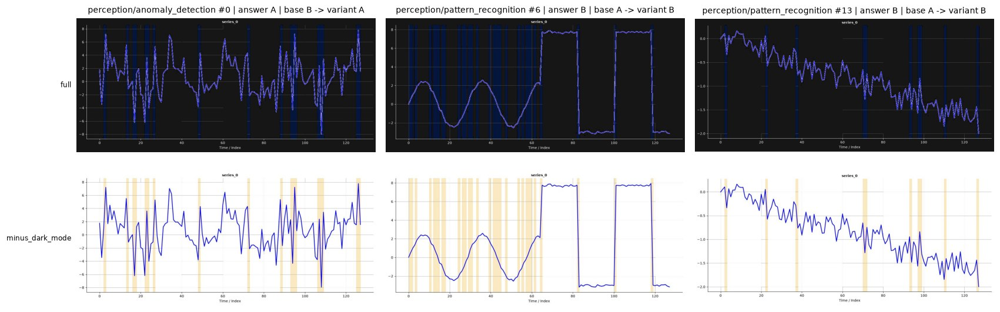
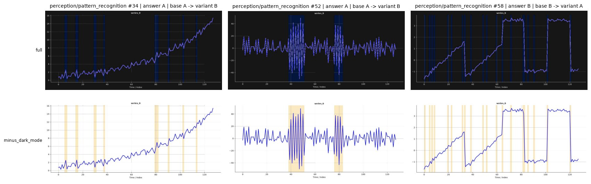
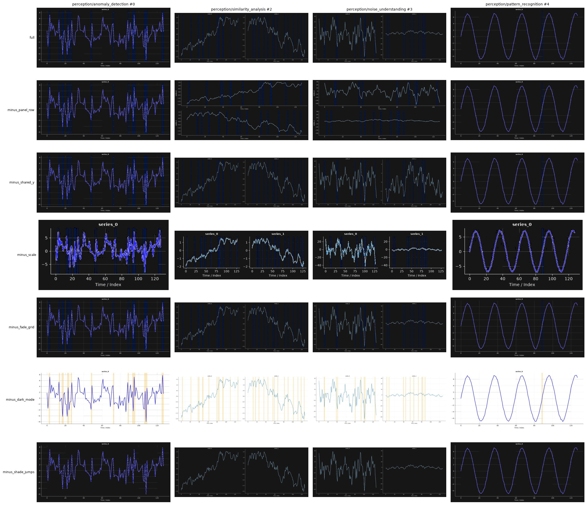

# 실험 보고서: perception_ablation_loo

perception 조합 chart 에서 요소를 하나씩 제거

- 생성: 2026-11-22T05:08:33+00:00
- 진행: 9800 / 9800 요청 완료 (100.0%)
- 대상: tsrbench/perception | 모델: qwen3-vl-4b | 입력: vision, text+vision
- sampling: `official`, repeats 1, max_tokens 없음(공식), text 값 간격 1
- 비교 기준(baseline): `full`

읽는 법

- 정확도: 처리가 끝난 문항 중 정답 비율. 답 글자를 못 뽑은 응답과 context 초과 문항은 오답으로 친다. 대괄호는 95% 신뢰구간.
- 공식 방식: TSRBench 공식 채점처럼 JSON 으로 읽히지 않은 응답을 분모에서 뺀 값.
- 차이: 같은 문항끼리 baseline 과 비교한 값(%p). 얻음/잃음 = baseline 에서 틀렸다가 맞은 / 맞았다가 틀린 문항 수.
- p: McNemar exact test. p(Holm) 은 같은 표 안의 여러 비교를 보정한 값이다.

## tsrbench / qwen3-vl-4b / vision

| chart | 문항 수 | 정확도 % [95% CI] | 차이 %p [95% CI] | 얻음 / 잃음 | p | p (Holm) | 공식 방식 % | 답 없음 | 처리율 |
| --- | --- | --- | --- | --- | --- | --- | --- | --- | --- |
| **full** (baseline) | 700 | 58.1 [54.5, 61.7] |  |  |  |  | 58.1 | 0 | 100% |
| minus_panel_row | 700 | 58.4 [54.7, 62.0] | +0.3 [-2.6, 3.1] | 53 / 51 | 0.922 | 1.000 | 58.4 | 0 | 100% |
| minus_shared_y | 700 | 57.6 [53.9, 61.2] | -0.6 [-3.4, 2.3] | 49 / 53 | 0.767 | 1.000 | 57.6 | 0 | 100% |
| minus_scale | 700 | 60.1 [56.5, 63.7] | +2.0 [-1.4, 5.4] | 83 / 69 | 0.292 | 1.000 | 60.4 | 3 | 100% |
| minus_fade_grid | 700 | 56.6 [52.9, 60.2] | -1.6 [-4.5, 1.3] | 48 / 59 | 0.334 | 1.000 | 56.6 | 0 | 100% |
| minus_dark_mode | 700 | 59.9 [56.2, 63.4] | +1.7 [-1.2, 4.6] | 60 / 48 | 0.290 | 1.000 | 59.9 | 0 | 100% |
| minus_shade_jumps | 700 | 61.9 [58.2, 65.4] | +3.7 [0.4, 7.0] | 83 / 57 | 0.034 | 0.205 | 61.9 | 0 | 100% |

기준선: 최빈 정답(A)만 찍으면 42.6%

### task 별 정확도 % (괄호: baseline 대비 %p)

| task | 문항 | full | minus_panel_row | minus_shared_y | minus_scale | minus_fade_grid | minus_dark_mode | minus_shade_jumps |
| --- | --- | --- | --- | --- | --- | --- | --- | --- |
| perception/anomaly_detection | 129 | 58.1 | 51.9 (-6.2) | 52.7 (-5.4) | 50.4 (-7.8) | 52.7 (-5.4) | 52.7 (-5.4) | 57.4 (-0.8) |
| perception/noise_understanding | 87 | 51.7 | 52.9 (+1.1) | 52.9 (+1.1) | 58.6 (+6.9) | 49.4 (-2.3) | 51.7 (+0.0) | 48.3 (-3.4) |
| perception/pattern_recognition | 371 | 58.0 | 60.1 (+2.2) | 58.2 (+0.3) | 60.9 (+3.0) | 58.5 (+0.5) | 63.3 (+5.4) | 65.2 (+7.3) |
| perception/similarity_analysis | 113 | 63.7 | 64.6 (+0.9) | 64.6 (+0.9) | 69.9 (+6.2) | 60.2 (-3.5) | 62.8 (-0.9) | 66.4 (+2.7) |

### baseline 과 정오가 바뀐 문항

- `minus_panel_row`: 얻음 53 (예: perception#5, perception#8, perception#12, perception#13, perception#43) / 잃음 51 (예: perception#20, perception#25, perception#26, perception#41, perception#48)
- `minus_shared_y`: 얻음 49 (예: perception#5, perception#13, perception#17, perception#43, perception#51) / 잃음 53 (예: perception#22, perception#26, perception#29, perception#49, perception#48)
- `minus_scale`: 얻음 83 (예: perception#8, perception#17, perception#21, perception#24, perception#15) / 잃음 69 (예: perception#20, perception#27, perception#25, perception#26, perception#29)
- `minus_fade_grid`: 얻음 48 (예: perception#5, perception#8, perception#42, perception#52, perception#40) / 잃음 59 (예: perception#0, perception#7, perception#25, perception#26, perception#41)
- `minus_dark_mode`: 얻음 60 (예: perception#13, perception#17, perception#21, perception#15, perception#43) / 잃음 48 (예: perception#7, perception#19, perception#22, perception#45, perception#48)
- `minus_shade_jumps`: 얻음 83 (예: perception#8, perception#17, perception#21, perception#15, perception#51) / 잃음 57 (예: perception#0, perception#1, perception#7, perception#19, perception#22)

`minus_shade_jumps` 에서 틀림 -> 맞음 인 문항 (위: baseline, 아래: 변형)

`minus_shade_jumps` 에서 맞음 -> 틀림 인 문항 (위: baseline, 아래: 변형)

### 비용과 입력 크기

| chart | 입력 tok | 출력 tok | 응답 시간 s (중앙값) | 이미지 수 | 이미지 px (최빈) | 이미지 KB | 재요청 | 길이 한도로 잘림 | 오류 | context 초과 |
| --- | --- | --- | --- | --- | --- | --- | --- | --- | --- | --- |
| full | 957 | 273 | 1.5 | 1.0 | 1213x544 | 140 | 17 | 0 | 0 | 0 |
| minus_panel_row | 866 | 268 | 1.4 | 1.0 | 1213x544 | 135 | 18 | 0 | 0 | 0 |
| minus_shared_y | 957 | 259 | 1.5 | 1.0 | 1213x544 | 147 | 17 | 0 | 0 | 0 |
| minus_scale | 245 | 299 | 1.3 | 1.0 | 438x236 | 46 | 19 | 3 | 0 | 0 |
| minus_fade_grid | 957 | 278 | 1.5 | 1.0 | 1213x544 | 142 | 19 | 0 | 0 | 0 |
| minus_dark_mode | 957 | 237 | 1.5 | 1.0 | 1213x544 | 214 | 12 | 0 | 0 | 0 |
| minus_shade_jumps | 957 | 253 | 1.5 | 1.0 | 1213x544 | 104 | 15 | 0 | 0 | 0 |

## tsrbench / qwen3-vl-4b / text+vision

| chart | 문항 수 | 정확도 % [95% CI] | 차이 %p [95% CI] | 얻음 / 잃음 | p | p (Holm) | 공식 방식 % | 답 없음 | 처리율 |
| --- | --- | --- | --- | --- | --- | --- | --- | --- | --- |
| **full** (baseline) | 700 | 53.7 [50.0, 57.4] |  |  |  |  | 53.7 | 0 | 100% |
| minus_panel_row | 700 | 55.6 [51.9, 59.2] | +1.9 [-0.3, 4.0] | 35 / 22 | 0.111 | 0.556 | 55.6 | 0 | 100% |
| minus_shared_y | 700 | 53.9 [50.2, 57.5] | +0.1 [-2.0, 2.3] | 31 / 30 | 1.000 | 1.000 | 53.9 | 0 | 100% |
| minus_scale | 700 | 53.7 [50.0, 57.4] | +0.0 [-2.4, 2.4] | 37 / 37 | 1.000 | 1.000 | 53.7 | 0 | 100% |
| minus_fade_grid | 700 | 53.9 [50.2, 57.5] | +0.1 [-2.2, 2.5] | 35 / 34 | 1.000 | 1.000 | 53.9 | 0 | 100% |
| minus_dark_mode | 700 | 51.6 [47.9, 55.3] | -2.1 [-4.5, 0.2] | 27 / 42 | 0.091 | 0.547 | 51.6 | 0 | 100% |
| minus_shade_jumps | 700 | 54.6 [50.9, 58.2] | +0.9 [-1.3, 3.0] | 33 / 27 | 0.519 | 1.000 | 54.6 | 0 | 100% |

기준선: 최빈 정답(A)만 찍으면 42.6%

### task 별 정확도 % (괄호: baseline 대비 %p)

| task | 문항 | full | minus_panel_row | minus_shared_y | minus_scale | minus_fade_grid | minus_dark_mode | minus_shade_jumps |
| --- | --- | --- | --- | --- | --- | --- | --- | --- |
| perception/anomaly_detection | 129 | 48.1 | 50.4 (+2.3) | 45.7 (-2.3) | 48.1 (+0.0) | 46.5 (-1.6) | 44.2 (-3.9) | 43.4 (-4.7) |
| perception/noise_understanding | 87 | 51.7 | 52.9 (+1.1) | 50.6 (-1.1) | 49.4 (-2.3) | 50.6 (-1.1) | 51.7 (+0.0) | 50.6 (-1.1) |
| perception/pattern_recognition | 371 | 56.3 | 57.7 (+1.3) | 56.1 (-0.3) | 55.5 (-0.8) | 57.1 (+0.8) | 53.4 (-3.0) | 59.3 (+3.0) |
| perception/similarity_analysis | 113 | 53.1 | 56.6 (+3.5) | 58.4 (+5.3) | 57.5 (+4.4) | 54.0 (+0.9) | 54.0 (+0.9) | 54.9 (+1.8) |

### baseline 과 정오가 바뀐 문항

- `minus_panel_row`: 얻음 35 (예: perception#0, perception#13, perception#35, perception#53, perception#51) / 잃음 22 (예: perception#34, perception#41, perception#58, perception#88, perception#94)
- `minus_shared_y`: 얻음 31 (예: perception#0, perception#6, perception#13, perception#35, perception#49) / 잃음 30 (예: perception#10, perception#34, perception#32, perception#50, perception#58)
- `minus_scale`: 얻음 37 (예: perception#0, perception#6, perception#13, perception#24, perception#35) / 잃음 37 (예: perception#34, perception#50, perception#58, perception#84, perception#113)
- `minus_fade_grid`: 얻음 35 (예: perception#6, perception#53, perception#51, perception#108, perception#116) / 잃음 34 (예: perception#34, perception#50, perception#58, perception#143, perception#153)
- `minus_dark_mode`: 얻음 27 (예: perception#0, perception#6, perception#13, perception#35, perception#49) / 잃음 42 (예: perception#34, perception#52, perception#58, perception#126, perception#146)
- `minus_shade_jumps`: 얻음 33 (예: perception#13, perception#49, perception#53, perception#51, perception#75) / 잃음 27 (예: perception#10, perception#153, perception#200, perception#203, perception#224)

`minus_dark_mode` 에서 틀림 -> 맞음 인 문항 (위: baseline, 아래: 변형)

`minus_dark_mode` 에서 맞음 -> 틀림 인 문항 (위: baseline, 아래: 변형)

### 비용과 입력 크기

| chart | 입력 tok | 출력 tok | 응답 시간 s (중앙값) | 이미지 수 | 이미지 px (최빈) | 이미지 KB | 재요청 | 길이 한도로 잘림 | 오류 | context 초과 |
| --- | --- | --- | --- | --- | --- | --- | --- | --- | --- | --- |
| full | 2000 | 14 | 0.5 | 1.0 | 1213x544 | 140 | 0 | 0 | 0 | 0 |
| minus_panel_row | 1909 | 14 | 0.5 | 1.0 | 1213x544 | 135 | 0 | 0 | 0 | 0 |
| minus_shared_y | 2000 | 14 | 0.5 | 1.0 | 1213x544 | 147 | 0 | 0 | 0 | 0 |
| minus_scale | 1289 | 14 | 0.4 | 1.0 | 438x236 | 46 | 0 | 0 | 0 | 0 |
| minus_fade_grid | 2000 | 14 | 0.7 | 1.0 | 1213x544 | 142 | 0 | 0 | 0 | 0 |
| minus_dark_mode | 2000 | 14 | 0.6 | 1.0 | 1213x544 | 214 | 0 | 0 | 0 | 0 |
| minus_shade_jumps | 2000 | 14 | 0.5 | 1.0 | 1213x544 | 104 | 0 | 0 | 0 | 0 |

## chart 예시

같은 문항을 chart 별로 그린 것 (행 = chart, 열 = 문항).

### perception

## 실행 환경과 설정

| model | 이름 | 서빙 설정 | 보낸 sampling | 서버 기본 sampling |
| --- | --- | --- | --- | --- |
| qwen3-vl-4b | Qwen/Qwen3-VL-4B-Instruct | dtype=float16, limit_mm_per_prompt={'image': 4}, revision=ebb281ec70b05090aa6165b016eac8ec08e71b17 | 없음 (서버 기본값 사용) | {'do_sample': True, 'temperature': 0.7, 'top_p': 0.8, 'top_k': 20, 'repetition_penalty': 1.0} |

- OS Linux 6.8.0-149-generic, Python 3.12.16, CPU Intel(R) Core(TM) Ultra 7 270K Plus (24 threads), RAM 62.1 GB
- GPU: NVIDIA GeForce RTX 5090 32GB | Colab: 아니오
- 패키지: matplotlib 3.11.2, pillow 13.0.0, numpy 2.5.4, openai 3.49.0, huggingface_hub 2.4.0, PyYAML 6.0.3, rich 15.0.0
- git commit: e89edb43 (커밋 안 된 수정 있음)

run 폴더 (raw 결과)

- `runs/tsrbench/perception/qwen3-vl-4b/vision/full__2a66339e` : tsrbench/perception | qwen3-vl-4b | vision | full
- `runs/tsrbench/perception/qwen3-vl-4b/vision/minus_panel_row__ecf88e5d` : tsrbench/perception | qwen3-vl-4b | vision | minus_panel_row
- `runs/tsrbench/perception/qwen3-vl-4b/vision/minus_shared_y__4962156f` : tsrbench/perception | qwen3-vl-4b | vision | minus_shared_y
- `runs/tsrbench/perception/qwen3-vl-4b/vision/minus_scale__5f2972f1` : tsrbench/perception | qwen3-vl-4b | vision | minus_scale
- `runs/tsrbench/perception/qwen3-vl-4b/vision/minus_fade_grid__53381f81` : tsrbench/perception | qwen3-vl-4b | vision | minus_fade_grid
- `runs/tsrbench/perception/qwen3-vl-4b/vision/minus_dark_mode__65910b72` : tsrbench/perception | qwen3-vl-4b | vision | minus_dark_mode
- `runs/tsrbench/perception/qwen3-vl-4b/vision/minus_shade_jumps__67534fa4` : tsrbench/perception | qwen3-vl-4b | vision | minus_shade_jumps
- `runs/tsrbench/perception/qwen3-vl-4b/text+vision/full__e693c693` : tsrbench/perception | qwen3-vl-4b | text+vision | full
- `runs/tsrbench/perception/qwen3-vl-4b/text+vision/minus_panel_row__84a073f8` : tsrbench/perception | qwen3-vl-4b | text+vision | minus_panel_row
- `runs/tsrbench/perception/qwen3-vl-4b/text+vision/minus_shared_y__8e1b0016` : tsrbench/perception | qwen3-vl-4b | text+vision | minus_shared_y
- `runs/tsrbench/perception/qwen3-vl-4b/text+vision/minus_scale__a64f0148` : tsrbench/perception | qwen3-vl-4b | text+vision | minus_scale
- `runs/tsrbench/perception/qwen3-vl-4b/text+vision/minus_fade_grid__172ee369` : tsrbench/perception | qwen3-vl-4b | text+vision | minus_fade_grid
- `runs/tsrbench/perception/qwen3-vl-4b/text+vision/minus_dark_mode__b2e6e269` : tsrbench/perception | qwen3-vl-4b | text+vision | minus_dark_mode
- `runs/tsrbench/perception/qwen3-vl-4b/text+vision/minus_shade_jumps__efe9d996` : tsrbench/perception | qwen3-vl-4b | text+vision | minus_shade_jumps

