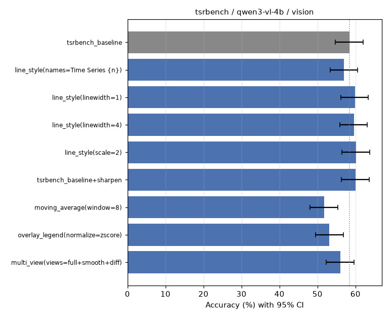
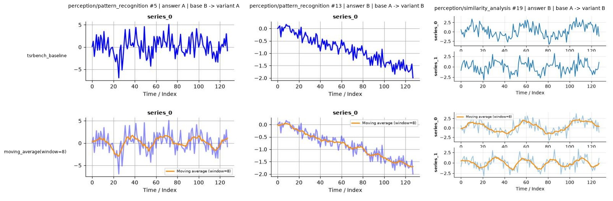
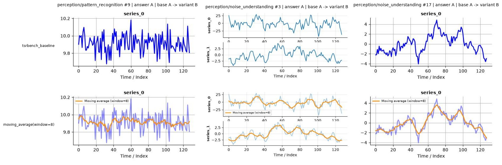
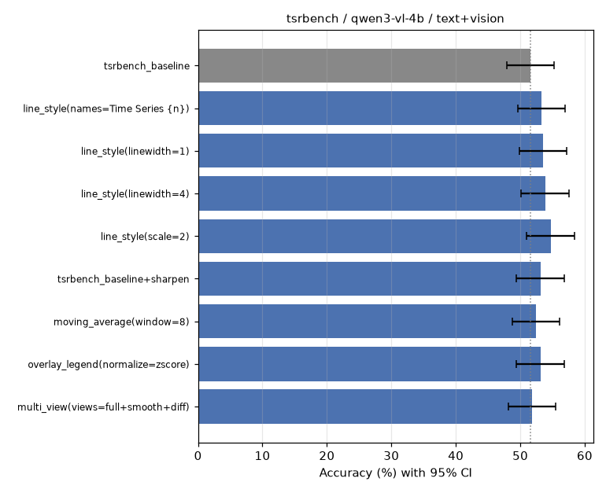
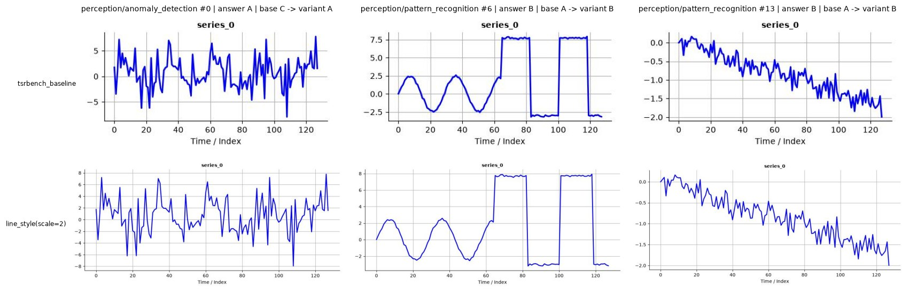
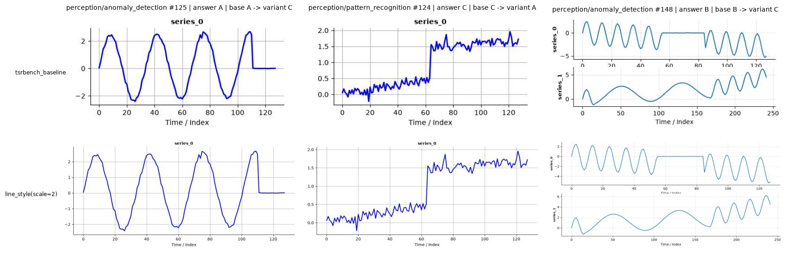
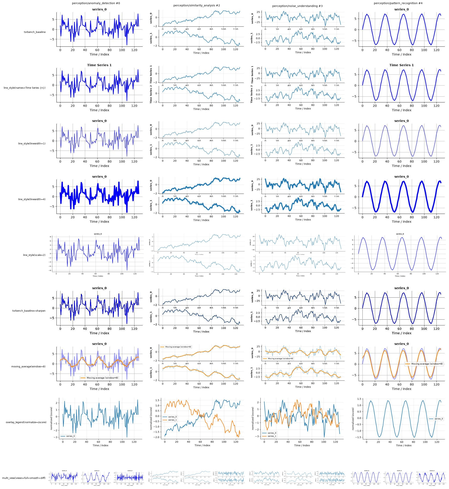

# 실험 보고서: perception_augment

perception 에서 chart 변형별 성능 비교

- 생성: 2026-11-18T00:44:17+00:00
- 진행: 12600 / 12600 요청 완료 (100.0%)
- 대상: tsrbench/perception | 모델: qwen3-vl-4b | 입력: vision, text+vision
- sampling: `official`, repeats 1, max_tokens 없음(공식), text 값 간격 1
- 비교 기준(baseline): `tsrbench_baseline`

읽는 법

- 정확도: 처리가 끝난 문항 중 정답 비율. 답 글자를 못 뽑은 응답과 context 초과 문항은 오답으로 친다. 대괄호는 95% 신뢰구간.
- 공식 방식: TSRBench 공식 채점처럼 JSON 으로 읽히지 않은 응답을 분모에서 뺀 값.
- 차이: 같은 문항끼리 baseline 과 비교한 값(%p). 얻음/잃음 = baseline 에서 틀렸다가 맞은 / 맞았다가 틀린 문항 수.
- p: McNemar exact test. p(Holm) 은 같은 표 안의 여러 비교를 보정한 값이다.

## tsrbench / qwen3-vl-4b / vision

| chart | 문항 수 | 정확도 % [95% CI] | 차이 %p [95% CI] | 얻음 / 잃음 | p | p (Holm) | 공식 방식 % | 답 없음 | 처리율 |
| --- | --- | --- | --- | --- | --- | --- | --- | --- | --- |
| **tsrbench_baseline** (baseline) | 700 | 58.4 [54.7, 62.0] |  |  |  |  | 58.7 | 3 | 100% |
| line_style(names=Time Series {n}) | 700 | 57.0 [53.3, 60.6] | -1.4 [-4.3, 1.4] | 47 / 57 | 0.378 | 1.000 | 57.1 | 1 | 100% |
| line_style(linewidth=1) | 700 | 59.9 [56.2, 63.4] | +1.4 [-1.4, 4.3] | 56 / 46 | 0.373 | 1.000 | 60.0 | 2 | 100% |
| line_style(linewidth=4) | 700 | 59.6 [55.9, 63.1] | +1.1 [-1.8, 4.1] | 60 / 52 | 0.509 | 1.000 | 59.8 | 3 | 100% |
| line_style(scale=2) | 700 | 60.1 [56.5, 63.7] | +1.7 [-1.6, 5.0] | 75 / 63 | 0.349 | 1.000 | 60.1 | 0 | 100% |
| tsrbench_baseline+sharpen | 700 | 60.0 [56.3, 63.6] | +1.6 [-1.2, 4.4] | 55 / 44 | 0.315 | 1.000 | 60.2 | 2 | 100% |
| moving_average(window=8) | 700 | 51.7 [48.0, 55.4] | -6.7 [-10.5, -2.9] | 69 / 116 | <0.001 | 0.005 | 51.8 | 1 | 100% |
| overlay_legend(normalize=zscore) | 700 | 53.1 [49.4, 56.8] | -5.3 [-9.1, -1.5] | 75 / 112 | 0.008 | 0.058 | 53.4 | 4 | 100% |
| multi_view(views=full+smooth+diff) | 700 | 56.0 [52.3, 59.6] | -2.4 [-6.1, 1.3] | 79 / 96 | 0.226 | 1.000 | 56.2 | 3 | 100% |

기준선: 최빈 정답(A)만 찍으면 42.6%

### task 별 정확도 % (괄호: baseline 대비 %p)

| task | 문항 | tsrbench_baseline | line_style(names=Time Series {n}) | line_style(linewidth=1) | line_style(linewidth=4) | line_style(scale=2) | tsrbench_baseline+sharpen | moving_average(window=8) | overlay_legend(normalize=zscore) | multi_view(views=full+smooth+diff) |
| --- | --- | --- | --- | --- | --- | --- | --- | --- | --- | --- |
| perception/anomaly_detection | 129 | 49.6 | 48.1 (-1.6) | 48.8 (-0.8) | 51.9 (+2.3) | 55.0 (+5.4) | 51.9 (+2.3) | 38.8 (-10.9) | 52.7 (+3.1) | 42.6 (-7.0) |
| perception/noise_understanding | 87 | 52.9 | 49.4 (-3.4) | 52.9 (+0.0) | 58.6 (+5.7) | 48.3 (-4.6) | 58.6 (+5.7) | 44.8 (-8.0) | 46.0 (-6.9) | 50.6 (-2.3) |
| perception/pattern_recognition | 371 | 61.2 | 59.6 (-1.6) | 64.7 (+3.5) | 61.2 (+0.0) | 63.3 (+2.2) | 63.1 (+1.9) | 55.8 (-5.4) | 55.5 (-5.7) | 60.9 (-0.3) |
| perception/similarity_analysis | 113 | 63.7 | 64.6 (+0.9) | 61.9 (-1.8) | 63.7 (+0.0) | 64.6 (+0.9) | 60.2 (-3.5) | 58.4 (-5.3) | 51.3 (-12.4) | 59.3 (-4.4) |

### baseline 과 정오가 바뀐 문항

- `line_style(names=Time Series {n})`: 얻음 47 (예: perception#15, perception#19, perception#25, perception#43, perception#41) / 잃음 57 (예: perception#12, perception#22, perception#92, perception#126, perception#154)
- `line_style(linewidth=1)`: 얻음 56 (예: perception#15, perception#19, perception#25, perception#30, perception#41) / 잃음 46 (예: perception#12, perception#92, perception#130, perception#142, perception#154)
- `line_style(linewidth=4)`: 얻음 60 (예: perception#5, perception#15, perception#25, perception#26, perception#30) / 잃음 52 (예: perception#12, perception#28, perception#52, perception#109, perception#130)
- `line_style(scale=2)`: 얻음 75 (예: perception#13, perception#15, perception#43, perception#39, perception#45) / 잃음 63 (예: perception#3, perception#10, perception#12, perception#17, perception#22)
- `tsrbench_baseline+sharpen`: 얻음 55 (예: perception#15, perception#19, perception#30, perception#43, perception#41) / 잃음 44 (예: perception#12, perception#22, perception#92, perception#94, perception#127)
- `moving_average(window=8)`: 얻음 69 (예: perception#5, perception#13, perception#19, perception#25, perception#43) / 잃음 116 (예: perception#9, perception#3, perception#17, perception#23, perception#27)
- `overlay_legend(normalize=zscore)`: 얻음 75 (예: perception#13, perception#19, perception#43, perception#48, perception#49) / 잃음 112 (예: perception#1, perception#6, perception#22, perception#23, perception#36)
- `multi_view(views=full+smooth+diff)`: 얻음 79 (예: perception#13, perception#19, perception#25, perception#43, perception#39) / 잃음 96 (예: perception#7, perception#12, perception#23, perception#32, perception#38)

`moving_average(window=8)` 에서 틀림 -> 맞음 인 문항 (위: baseline, 아래: 변형)

`moving_average(window=8)` 에서 맞음 -> 틀림 인 문항 (위: baseline, 아래: 변형)

### 비용과 입력 크기

| chart | 입력 tok | 출력 tok | 응답 시간 s (중앙값) | 이미지 수 | 이미지 px (최빈) | 이미지 KB | 재요청 | 길이 한도로 잘림 | 오류 | context 초과 |
| --- | --- | --- | --- | --- | --- | --- | --- | --- | --- | --- |
| tsrbench_baseline | 244 | 325 | 1.3 | 1.0 | 438x236 | 17 | 23 | 3 | 0 | 0 |
| line_style(names=Time Series {n}) | 244 | 309 | 1.2 | 1.0 | 438x236 | 18 | 22 | 1 | 0 | 0 |
| line_style(linewidth=1) | 244 | 299 | 1.3 | 1.0 | 438x236 | 16 | 18 | 2 | 0 | 0 |
| line_style(linewidth=4) | 244 | 348 | 1.3 | 1.0 | 438x236 | 18 | 28 | 3 | 0 | 0 |
| line_style(scale=2) | 481 | 295 | 1.4 | 1.0 | 825x390 | 38 | 19 | 0 | 0 | 0 |
| tsrbench_baseline+sharpen | 244 | 335 | 1.3 | 1.0 | 438x236 | 46 | 25 | 2 | 0 | 0 |
| moving_average(window=8) | 244 | 355 | 1.4 | 1.0 | 438x236 | 17 | 26 | 1 | 0 | 0 |
| overlay_legend(normalize=zscore) | 290 | 397 | 1.4 | 1.0 | 535x294 | 21 | 32 | 4 | 0 | 0 |
| multi_view(views=full+smooth+diff) | 498 | 497 | 1.8 | 3.0 | 438x236 | 17 | 40 | 3 | 0 | 0 |

## tsrbench / qwen3-vl-4b / text+vision

| chart | 문항 수 | 정확도 % [95% CI] | 차이 %p [95% CI] | 얻음 / 잃음 | p | p (Holm) | 공식 방식 % | 답 없음 | 처리율 |
| --- | --- | --- | --- | --- | --- | --- | --- | --- | --- |
| **tsrbench_baseline** (baseline) | 700 | 51.6 [47.9, 55.3] |  |  |  |  | 51.6 | 0 | 100% |
| line_style(names=Time Series {n}) | 700 | 53.3 [49.6, 57.0] | +1.7 [-0.5, 3.9] | 37 / 25 | 0.162 | 0.762 | 53.3 | 0 | 100% |
| line_style(linewidth=1) | 700 | 53.6 [49.9, 57.2] | +2.0 [-0.1, 4.1] | 36 / 22 | 0.087 | 0.522 | 53.6 | 0 | 100% |
| line_style(linewidth=4) | 700 | 53.9 [50.2, 57.5] | +2.3 [0.1, 4.5] | 40 / 24 | 0.060 | 0.420 | 53.9 | 0 | 100% |
| line_style(scale=2) | 700 | 54.7 [51.0, 58.4] | +3.1 [0.8, 5.5] | 46 / 24 | 0.012 | 0.092 | 54.7 | 0 | 100% |
| tsrbench_baseline+sharpen | 700 | 53.1 [49.4, 56.8] | +1.6 [-0.4, 3.5] | 30 / 19 | 0.152 | 0.762 | 53.1 | 0 | 100% |
| moving_average(window=8) | 700 | 52.4 [48.7, 56.1] | +0.9 [-1.3, 3.1] | 34 / 28 | 0.526 | 1.000 | 52.4 | 0 | 100% |
| overlay_legend(normalize=zscore) | 700 | 53.1 [49.4, 56.8] | +1.6 [-0.7, 3.9] | 39 / 28 | 0.222 | 0.762 | 53.1 | 0 | 100% |
| multi_view(views=full+smooth+diff) | 700 | 51.9 [48.2, 55.5] | +0.3 [-2.1, 2.7] | 38 / 36 | 0.908 | 1.000 | 51.9 | 0 | 100% |

기준선: 최빈 정답(A)만 찍으면 42.6%

### task 별 정확도 % (괄호: baseline 대비 %p)

| task | 문항 | tsrbench_baseline | line_style(names=Time Series {n}) | line_style(linewidth=1) | line_style(linewidth=4) | line_style(scale=2) | tsrbench_baseline+sharpen | moving_average(window=8) | overlay_legend(normalize=zscore) | multi_view(views=full+smooth+diff) |
| --- | --- | --- | --- | --- | --- | --- | --- | --- | --- | --- |
| perception/anomaly_detection | 129 | 43.4 | 42.6 (-0.8) | 45.0 (+1.6) | 45.0 (+1.6) | 46.5 (+3.1) | 42.6 (-0.8) | 41.1 (-2.3) | 42.6 (-0.8) | 47.3 (+3.9) |
| perception/noise_understanding | 87 | 49.4 | 49.4 (+0.0) | 49.4 (+0.0) | 52.9 (+3.4) | 51.7 (+2.3) | 49.4 (+0.0) | 47.1 (-2.3) | 49.4 (+0.0) | 47.1 (-2.3) |
| perception/pattern_recognition | 371 | 54.4 | 55.8 (+1.3) | 56.1 (+1.6) | 55.8 (+1.3) | 57.1 (+2.7) | 56.6 (+2.2) | 55.8 (+1.3) | 55.5 (+1.1) | 54.4 (+0.0) |
| perception/similarity_analysis | 113 | 53.1 | 60.2 (+7.1) | 58.4 (+5.3) | 58.4 (+5.3) | 58.4 (+5.3) | 56.6 (+3.5) | 58.4 (+5.3) | 60.2 (+7.1) | 52.2 (-0.9) |

### baseline 과 정오가 바뀐 문항

- `line_style(names=Time Series {n})`: 얻음 37 (예: perception#0, perception#6, perception#24, perception#34, perception#49) / 잃음 25 (예: perception#108, perception#143, perception#141, perception#148, perception#203)
- `line_style(linewidth=1)`: 얻음 36 (예: perception#0, perception#6, perception#50, perception#58, perception#75) / 잃음 22 (예: perception#84, perception#108, perception#125, perception#124, perception#141)
- `line_style(linewidth=4)`: 얻음 40 (예: perception#6, perception#13, perception#24, perception#47, perception#50) / 잃음 24 (예: perception#124, perception#142, perception#141, perception#148, perception#153)
- `line_style(scale=2)`: 얻음 46 (예: perception#0, perception#6, perception#13, perception#21, perception#45) / 잃음 24 (예: perception#125, perception#124, perception#148, perception#175, perception#219)
- `tsrbench_baseline+sharpen`: 얻음 30 (예: perception#0, perception#45, perception#47, perception#50, perception#54) / 잃음 19 (예: perception#84, perception#108, perception#125, perception#124, perception#141)
- `moving_average(window=8)`: 얻음 34 (예: perception#6, perception#13, perception#12, perception#34, perception#45) / 잃음 28 (예: perception#25, perception#32, perception#108, perception#124, perception#126)
- `overlay_legend(normalize=zscore)`: 얻음 39 (예: perception#0, perception#2, perception#6, perception#13, perception#24) / 잃음 28 (예: perception#84, perception#108, perception#125, perception#124, perception#141)
- `multi_view(views=full+smooth+diff)`: 얻음 38 (예: perception#0, perception#13, perception#50, perception#51, perception#58) / 잃음 36 (예: perception#41, perception#125, perception#142, perception#140, perception#148)

`line_style(scale=2)` 에서 틀림 -> 맞음 인 문항 (위: baseline, 아래: 변형)

`line_style(scale=2)` 에서 맞음 -> 틀림 인 문항 (위: baseline, 아래: 변형)

### 비용과 입력 크기

| chart | 입력 tok | 출력 tok | 응답 시간 s (중앙값) | 이미지 수 | 이미지 px (최빈) | 이미지 KB | 재요청 | 길이 한도로 잘림 | 오류 | context 초과 |
| --- | --- | --- | --- | --- | --- | --- | --- | --- | --- | --- |
| tsrbench_baseline | 1288 | 14 | 0.5 | 1.0 | 438x236 | 17 | 0 | 0 | 0 | 0 |
| line_style(names=Time Series {n}) | 1288 | 14 | 0.4 | 1.0 | 438x236 | 18 | 0 | 0 | 0 | 0 |
| line_style(linewidth=1) | 1288 | 14 | 0.4 | 1.0 | 438x236 | 16 | 0 | 0 | 0 | 0 |
| line_style(linewidth=4) | 1288 | 14 | 0.5 | 1.0 | 438x236 | 18 | 0 | 0 | 0 | 0 |
| line_style(scale=2) | 1525 | 14 | 0.5 | 1.0 | 825x390 | 38 | 0 | 0 | 0 | 0 |
| tsrbench_baseline+sharpen | 1288 | 14 | 0.4 | 1.0 | 438x236 | 46 | 0 | 0 | 0 | 0 |
| moving_average(window=8) | 1288 | 14 | 0.4 | 1.0 | 438x236 | 17 | 0 | 0 | 0 | 0 |
| overlay_legend(normalize=zscore) | 1334 | 14 | 0.5 | 1.0 | 535x294 | 21 | 0 | 0 | 0 | 0 |
| multi_view(views=full+smooth+diff) | 1542 | 14 | 0.3 | 3.0 | 438x236 | 17 | 0 | 0 | 0 | 0 |

## chart 예시

같은 문항을 chart 별로 그린 것 (행 = chart, 열 = 문항).

### perception

## 실행 환경과 설정

| model | 이름 | 서빙 설정 | 보낸 sampling | 서버 기본 sampling |
| --- | --- | --- | --- | --- |
| qwen3-vl-4b | Qwen/Qwen3-VL-4B-Instruct | dtype=float16, limit_mm_per_prompt={'image': 4}, revision=ebb281ec70b05090aa6165b016eac8ec08e71b17 | 없음 (서버 기본값 사용) | {'do_sample': True, 'temperature': 0.7, 'top_p': 0.8, 'top_k': 20, 'repetition_penalty': 1.0} |

- OS Linux 6.8.0-147-generic, Python 3.12.16, CPU Intel(R) Core(TM) Ultra 7 270K Plus (24 threads), RAM 62.1 GB
- GPU: NVIDIA GeForce RTX 5090 32GB | Colab: 아니오
- 패키지: matplotlib 3.11.2, pillow 13.0.0, numpy 2.5.4, openai 3.49.0, huggingface_hub 2.4.0, PyYAML 6.0.3, rich 15.0.0
- git commit: a6b8b573

run 폴더 (raw 결과)

- `runs/tsrbench/perception/qwen3-vl-4b/vision/tsrbench_baseline__5357ce0e` : tsrbench/perception | qwen3-vl-4b | vision | tsrbench_baseline
- `runs/tsrbench/perception/qwen3-vl-4b/vision/line_style-namesTime-Series-n__e4ebb15b` : tsrbench/perception | qwen3-vl-4b | vision | line_style(names=Time Series {n})
- `runs/tsrbench/perception/qwen3-vl-4b/vision/line_style-linewidth1__3331bb97` : tsrbench/perception | qwen3-vl-4b | vision | line_style(linewidth=1)
- `runs/tsrbench/perception/qwen3-vl-4b/vision/line_style-linewidth4__5c94a4c7` : tsrbench/perception | qwen3-vl-4b | vision | line_style(linewidth=4)
- `runs/tsrbench/perception/qwen3-vl-4b/vision/line_style-scale2__cc60431a` : tsrbench/perception | qwen3-vl-4b | vision | line_style(scale=2)
- `runs/tsrbench/perception/qwen3-vl-4b/vision/tsrbench_baseline+sharpen__daa16c1b` : tsrbench/perception | qwen3-vl-4b | vision | tsrbench_baseline+sharpen
- `runs/tsrbench/perception/qwen3-vl-4b/vision/moving_average-window8__9b27449b` : tsrbench/perception | qwen3-vl-4b | vision | moving_average(window=8)
- `runs/tsrbench/perception/qwen3-vl-4b/vision/overlay_legend-normalizezscore__08cdb32c` : tsrbench/perception | qwen3-vl-4b | vision | overlay_legend(normalize=zscore)
- `runs/tsrbench/perception/qwen3-vl-4b/vision/multi_view-viewsfull+smooth+diff__db2fe983` : tsrbench/perception | qwen3-vl-4b | vision | multi_view(views=full+smooth+diff)
- `runs/tsrbench/perception/qwen3-vl-4b/text+vision/tsrbench_baseline__210a1cd1` : tsrbench/perception | qwen3-vl-4b | text+vision | tsrbench_baseline
- `runs/tsrbench/perception/qwen3-vl-4b/text+vision/line_style-namesTime-Series-n__c48cb37e` : tsrbench/perception | qwen3-vl-4b | text+vision | line_style(names=Time Series {n})
- `runs/tsrbench/perception/qwen3-vl-4b/text+vision/line_style-linewidth1__ce40b877` : tsrbench/perception | qwen3-vl-4b | text+vision | line_style(linewidth=1)
- `runs/tsrbench/perception/qwen3-vl-4b/text+vision/line_style-linewidth4__284f7641` : tsrbench/perception | qwen3-vl-4b | text+vision | line_style(linewidth=4)
- `runs/tsrbench/perception/qwen3-vl-4b/text+vision/line_style-scale2__1ec4aaec` : tsrbench/perception | qwen3-vl-4b | text+vision | line_style(scale=2)
- `runs/tsrbench/perception/qwen3-vl-4b/text+vision/tsrbench_baseline+sharpen__f3c00859` : tsrbench/perception | qwen3-vl-4b | text+vision | tsrbench_baseline+sharpen
- `runs/tsrbench/perception/qwen3-vl-4b/text+vision/moving_average-window8__6e908c97` : tsrbench/perception | qwen3-vl-4b | text+vision | moving_average(window=8)
- `runs/tsrbench/perception/qwen3-vl-4b/text+vision/overlay_legend-normalizezscore__dd2a264b` : tsrbench/perception | qwen3-vl-4b | text+vision | overlay_legend(normalize=zscore)
- `runs/tsrbench/perception/qwen3-vl-4b/text+vision/multi_view-viewsfull+smooth+diff__f89bf8b3` : tsrbench/perception | qwen3-vl-4b | text+vision | multi_view(views=full+smooth+diff)

