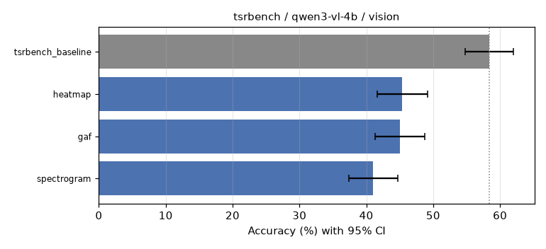
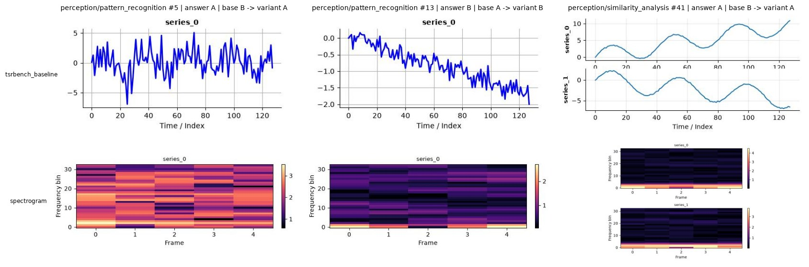
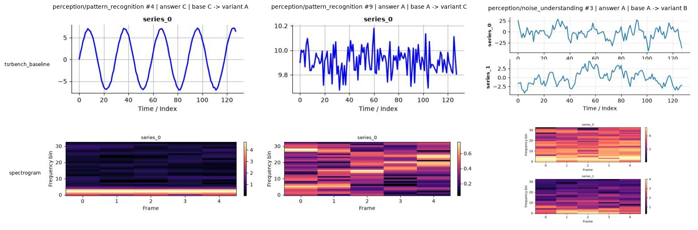
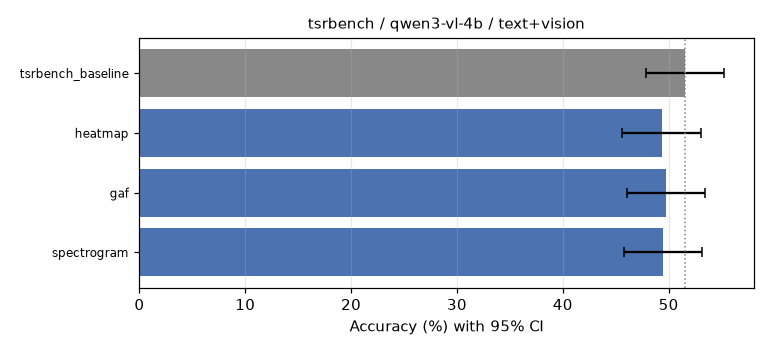
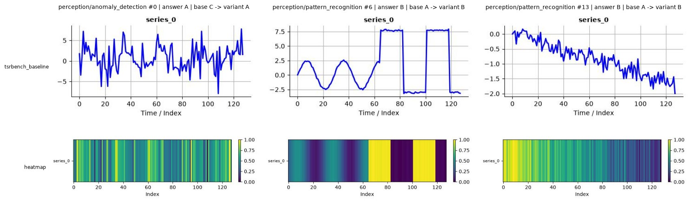
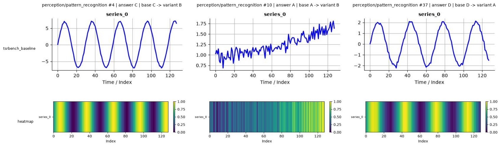
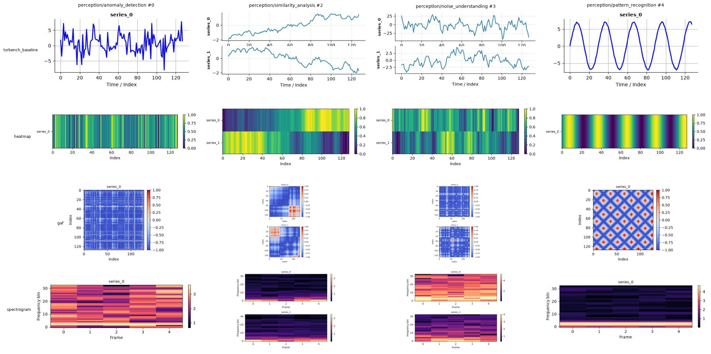

# 실험 보고서: perception_augment_format

perception 시계열을 heatmap, GAF, spectrogram 으로 그리기

- 생성: 2026-11-17T08:42:05+00:00
- 진행: 5562 / 5600 요청 완료 (99.3%) - **미완료 상태의 중간 결과**
- 대상: tsrbench/perception | 모델: qwen3-vl-4b | 입력: vision, text+vision
- sampling: `official`, repeats 1, max_tokens 없음(공식), text 값 간격 1
- 비교 기준(baseline): `tsrbench_baseline`

읽는 법

- 정확도: 처리가 끝난 문항 중 정답 비율. 답 글자를 못 뽑은 응답과 context 초과 문항은 오답으로 친다. 대괄호는 95% 신뢰구간.
- 공식 방식: TSRBench 공식 채점처럼 JSON 으로 읽히지 않은 응답을 분모에서 뺀 값.
- 차이: 같은 문항끼리 baseline 과 비교한 값(%p). 얻음/잃음 = baseline 에서 틀렸다가 맞은 / 맞았다가 틀린 문항 수.
- p: McNemar exact test. p(Holm) 은 같은 표 안의 여러 비교를 보정한 값이다.

## tsrbench / qwen3-vl-4b / vision

| chart | 문항 수 | 정확도 % [95% CI] | 차이 %p [95% CI] | 얻음 / 잃음 | p | p (Holm) | 공식 방식 % | 답 없음 | 처리율 |
| --- | --- | --- | --- | --- | --- | --- | --- | --- | --- |
| **tsrbench_baseline** (baseline) | 700 | 58.4 [54.7, 62.0] |  |  |  |  | 58.7 | 3 | 100% |
| heatmap | 681 | 45.4 [41.7, 49.1] | -13.1 [-17.5, -8.7] | 78 / 167 | <0.001 | <0.001 | 45.4 | 1 | 97% |
| gaf | 700 | 45.0 [41.4, 48.7] | -13.4 [-17.7, -9.1] | 78 / 172 | <0.001 | <0.001 | 45.1 | 1 | 100% |
| spectrogram | 700 | 41.0 [37.4, 44.7] | -17.4 [-21.8, -13.0] | 73 / 195 | <0.001 | <0.001 | 41.0 | 0 | 100% |

기준선: 최빈 정답(A)만 찍으면 42.6%

### task 별 정확도 % (괄호: baseline 대비 %p)

| task | 문항 | tsrbench_baseline | heatmap | gaf | spectrogram |
| --- | --- | --- | --- | --- | --- |
| perception/anomaly_detection | 129 | 49.6 | 43.6 (-6.0) | 46.5 (-3.1) | 40.3 (-9.3) |
| perception/noise_understanding | 87 | 52.9 | 44.8 (-8.0) | 46.0 (-6.9) | 42.5 (-10.3) |
| perception/pattern_recognition | 371 | 61.2 | 43.1 (-18.1) | 39.1 (-22.1) | 36.4 (-24.8) |
| perception/similarity_analysis | 113 | 63.7 | 54.9 (-8.8) | 61.9 (-1.8) | 55.8 (-8.0) |

### baseline 과 정오가 바뀐 문항

- `heatmap`: 얻음 78 (예: perception#5, perception#18, perception#19, perception#43, perception#41) / 잃음 167 (예: perception#7, perception#9, perception#3, perception#6, perception#17)
- `gaf`: 얻음 78 (예: perception#5, perception#13, perception#18, perception#19, perception#25) / 잃음 172 (예: perception#10, perception#12, perception#6, perception#22, perception#23)
- `spectrogram`: 얻음 73 (예: perception#5, perception#13, perception#41, perception#39, perception#45) / 잃음 195 (예: perception#4, perception#9, perception#3, perception#10, perception#12)

`spectrogram` 에서 틀림 -> 맞음 인 문항 (위: baseline, 아래: 변형)

`spectrogram` 에서 맞음 -> 틀림 인 문항 (위: baseline, 아래: 변형)

### 비용과 입력 크기

| chart | 입력 tok | 출력 tok | 응답 시간 s (중앙값) | 이미지 수 | 이미지 px (최빈) | 이미지 KB | 재요청 | 길이 한도로 잘림 | 오류 | context 초과 |
| --- | --- | --- | --- | --- | --- | --- | --- | --- | --- | --- |
| tsrbench_baseline | 244 | 325 | 1.3 | 1.0 | 438x236 | 17 | 23 | 3 | 0 | 0 |
| heatmap | 252 | 495 | 1.5 | 1.0 | 595x190 | 16 | 40 | 1 | 19 | 0 |
| gaf | 288 | 448 | 1.5 | 1.0 | 380x310 | 27 | 37 | 1 | 0 | 0 |
| spectrogram | 300 | 404 | 1.6 | 1.0 | 585x230 | 23 | 32 | 0 | 0 | 0 |

## tsrbench / qwen3-vl-4b / text+vision

| chart | 문항 수 | 정확도 % [95% CI] | 차이 %p [95% CI] | 얻음 / 잃음 | p | p (Holm) | 공식 방식 % | 답 없음 | 처리율 |
| --- | --- | --- | --- | --- | --- | --- | --- | --- | --- |
| **tsrbench_baseline** (baseline) | 700 | 51.6 [47.9, 55.3] |  |  |  |  | 51.6 | 0 | 100% |
| heatmap | 681 | 49.3 [45.6, 53.1] | -2.9 [-5.4, -0.4] | 28 / 48 | 0.029 | 0.086 | 49.3 | 0 | 97% |
| gaf | 700 | 49.7 [46.0, 53.4] | -1.9 [-4.6, 0.9] | 41 / 54 | 0.218 | 0.292 | 49.7 | 0 | 100% |
| spectrogram | 700 | 49.4 [45.7, 53.1] | -2.1 [-4.8, 0.6] | 39 / 54 | 0.146 | 0.292 | 49.4 | 0 | 100% |

기준선: 최빈 정답(A)만 찍으면 42.6%

### task 별 정확도 % (괄호: baseline 대비 %p)

| task | 문항 | tsrbench_baseline | heatmap | gaf | spectrogram |
| --- | --- | --- | --- | --- | --- |
| perception/anomaly_detection | 129 | 43.4 | 43.6 (+0.2) | 38.8 (-4.7) | 43.4 (+0.0) |
| perception/noise_understanding | 87 | 49.4 | 49.4 (+0.0) | 51.7 (+2.3) | 51.7 (+2.3) |
| perception/pattern_recognition | 371 | 54.4 | 49.1 (-5.4) | 48.2 (-6.2) | 48.5 (-5.9) |
| perception/similarity_analysis | 113 | 53.1 | 55.8 (+2.7) | 65.5 (+12.4) | 57.5 (+4.4) |

### baseline 과 정오가 바뀐 문항

- `heatmap`: 얻음 28 (예: perception#0, perception#6, perception#13, perception#34, perception#59) / 잃음 48 (예: perception#4, perception#10, perception#37, perception#108, perception#124)
- `gaf`: 얻음 41 (예: perception#0, perception#6, perception#13, perception#12, perception#34) / 잃음 54 (예: perception#10, perception#41, perception#64, perception#84, perception#92)
- `spectrogram`: 얻음 39 (예: perception#0, perception#13, perception#21, perception#49, perception#59) / 잃음 54 (예: perception#4, perception#10, perception#25, perception#31, perception#32)

`heatmap` 에서 틀림 -> 맞음 인 문항 (위: baseline, 아래: 변형)

`heatmap` 에서 맞음 -> 틀림 인 문항 (위: baseline, 아래: 변형)

### 비용과 입력 크기

| chart | 입력 tok | 출력 tok | 응답 시간 s (중앙값) | 이미지 수 | 이미지 px (최빈) | 이미지 KB | 재요청 | 길이 한도로 잘림 | 오류 | context 초과 |
| --- | --- | --- | --- | --- | --- | --- | --- | --- | --- | --- |
| tsrbench_baseline | 1288 | 14 | 0.5 | 1.0 | 438x236 | 17 | 0 | 0 | 0 | 0 |
| heatmap | 1263 | 14 | 0.4 | 1.0 | 595x190 | 16 | 0 | 0 | 19 | 0 |
| gaf | 1332 | 14 | 0.4 | 1.0 | 380x310 | 27 | 0 | 0 | 0 | 0 |
| spectrogram | 1344 | 14 | 0.4 | 1.0 | 585x230 | 23 | 0 | 0 | 0 | 0 |

## chart 예시

같은 문항을 chart 별로 그린 것 (행 = chart, 열 = 문항).

### perception

## 실행 환경과 설정

| model | 이름 | 서빙 설정 | 보낸 sampling | 서버 기본 sampling |
| --- | --- | --- | --- | --- |
| qwen3-vl-4b | Qwen/Qwen3-VL-4B-Instruct | dtype=float16, limit_mm_per_prompt={'image': 4}, revision=ebb281ec70b05090aa6165b016eac8ec08e71b17 | 없음 (서버 기본값 사용) | {'do_sample': True, 'temperature': 0.7, 'top_p': 0.8, 'top_k': 20, 'repetition_penalty': 1.0} |

- OS Linux 6.8.0-147-generic, Python 3.12.16, CPU Intel(R) Core(TM) Ultra 7 270K Plus (24 threads), RAM 62.1 GB
- GPU: NVIDIA GeForce RTX 5090 32GB | Colab: 아니오
- 패키지: matplotlib 3.11.2, pillow 13.0.0, numpy 2.5.4, openai 3.49.0, huggingface_hub 2.4.0, PyYAML 6.0.3, rich 15.0.0
- git commit: a6b8b573

run 폴더 (raw 결과)

- `runs/tsrbench/perception/qwen3-vl-4b/vision/tsrbench_baseline__5357ce0e` : tsrbench/perception | qwen3-vl-4b | vision | tsrbench_baseline
- `runs/tsrbench/perception/qwen3-vl-4b/vision/heatmap__6f78ab03` : tsrbench/perception | qwen3-vl-4b | vision | heatmap
- `runs/tsrbench/perception/qwen3-vl-4b/vision/gaf__bf0872a2` : tsrbench/perception | qwen3-vl-4b | vision | gaf
- `runs/tsrbench/perception/qwen3-vl-4b/vision/spectrogram__54128d7e` : tsrbench/perception | qwen3-vl-4b | vision | spectrogram
- `runs/tsrbench/perception/qwen3-vl-4b/text+vision/tsrbench_baseline__210a1cd1` : tsrbench/perception | qwen3-vl-4b | text+vision | tsrbench_baseline
- `runs/tsrbench/perception/qwen3-vl-4b/text+vision/heatmap__9a5a7478` : tsrbench/perception | qwen3-vl-4b | text+vision | heatmap
- `runs/tsrbench/perception/qwen3-vl-4b/text+vision/gaf__21d1c42b` : tsrbench/perception | qwen3-vl-4b | text+vision | gaf
- `runs/tsrbench/perception/qwen3-vl-4b/text+vision/spectrogram__f23049fe` : tsrbench/perception | qwen3-vl-4b | text+vision | spectrogram

