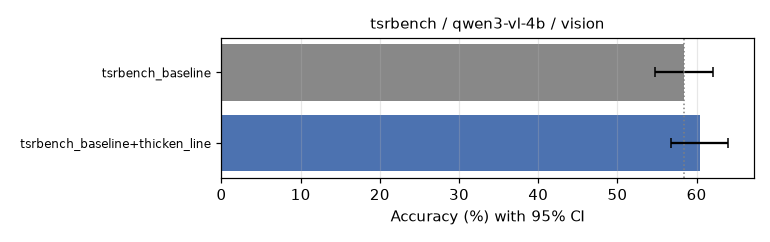
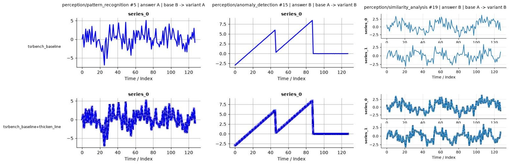
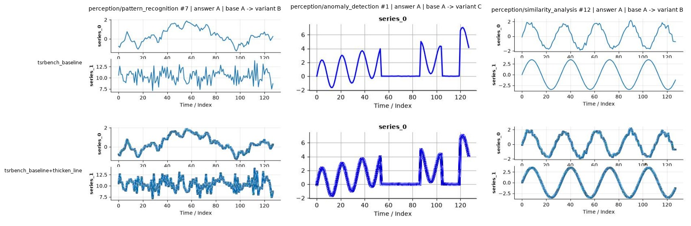
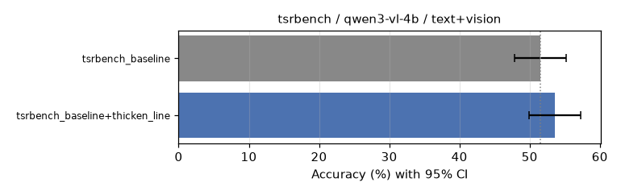
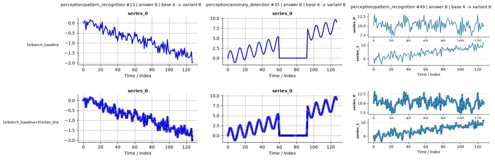
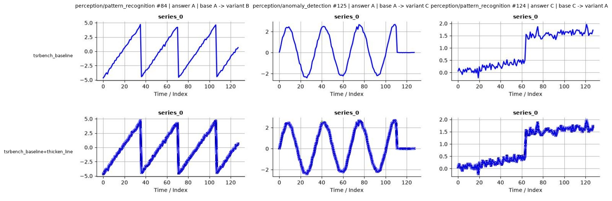
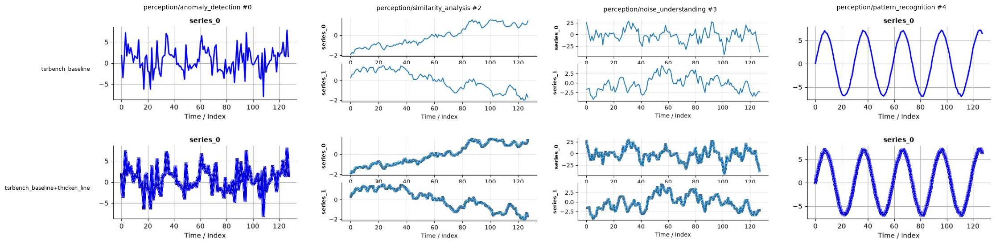

# 실험 보고서: perception_augment_km

perception 공식 그림의 데이터 선만 두껍게

- 생성: 2026-11-18T00:46:38+00:00
- 진행: 2800 / 2800 요청 완료 (100.0%)
- 대상: tsrbench/perception | 모델: qwen3-vl-4b | 입력: vision, text+vision
- sampling: `official`, repeats 1, max_tokens 없음(공식), text 값 간격 1
- 비교 기준(baseline): `tsrbench_baseline`

읽는 법

- 정확도: 처리가 끝난 문항 중 정답 비율. 답 글자를 못 뽑은 응답과 context 초과 문항은 오답으로 친다. 대괄호는 95% 신뢰구간.
- 공식 방식: TSRBench 공식 채점처럼 JSON 으로 읽히지 않은 응답을 분모에서 뺀 값.
- 차이: 같은 문항끼리 baseline 과 비교한 값(%p). 얻음/잃음 = baseline 에서 틀렸다가 맞은 / 맞았다가 틀린 문항 수.
- p: McNemar exact test. p(Holm) 은 같은 표 안의 여러 비교를 보정한 값이다.

## tsrbench / qwen3-vl-4b / vision

| chart | 문항 수 | 정확도 % [95% CI] | 차이 %p [95% CI] | 얻음 / 잃음 | p | p (Holm) | 공식 방식 % | 답 없음 | 처리율 |
| --- | --- | --- | --- | --- | --- | --- | --- | --- | --- |
| **tsrbench_baseline** (baseline) | 700 | 58.4 [54.7, 62.0] |  |  |  |  | 58.7 | 3 | 100% |
| tsrbench_baseline+thicken_line | 700 | 60.4 [56.8, 64.0] | +2.0 [-1.1, 5.1] | 67 / 53 | 0.235 | 0.235 | 60.5 | 1 | 100% |

기준선: 최빈 정답(A)만 찍으면 42.6%

### task 별 정확도 % (괄호: baseline 대비 %p)

| task | 문항 | tsrbench_baseline | tsrbench_baseline+thicken_line |
| --- | --- | --- | --- |
| perception/anomaly_detection | 129 | 49.6 | 51.2 (+1.6) |
| perception/noise_understanding | 87 | 52.9 | 60.9 (+8.0) |
| perception/pattern_recognition | 371 | 61.2 | 61.5 (+0.3) |
| perception/similarity_analysis | 113 | 63.7 | 67.3 (+3.5) |

### baseline 과 정오가 바뀐 문항

- `tsrbench_baseline+thicken_line`: 얻음 67 (예: perception#5, perception#15, perception#19, perception#30, perception#43) / 잃음 53 (예: perception#7, perception#1, perception#12, perception#92, perception#126)

`tsrbench_baseline+thicken_line` 에서 틀림 -> 맞음 인 문항 (위: baseline, 아래: 변형)

`tsrbench_baseline+thicken_line` 에서 맞음 -> 틀림 인 문항 (위: baseline, 아래: 변형)

### 비용과 입력 크기

| chart | 입력 tok | 출력 tok | 응답 시간 s (중앙값) | 이미지 수 | 이미지 px (최빈) | 이미지 KB | 재요청 | 길이 한도로 잘림 | 오류 | context 초과 |
| --- | --- | --- | --- | --- | --- | --- | --- | --- | --- | --- |
| tsrbench_baseline | 244 | 325 | 1.3 | 1.0 | 438x236 | 17 | 23 | 3 | 0 | 0 |
| tsrbench_baseline+thicken_line | 244 | 315 | 1.3 | 1.0 | 438x236 | 62 | 21 | 1 | 0 | 0 |

## tsrbench / qwen3-vl-4b / text+vision

| chart | 문항 수 | 정확도 % [95% CI] | 차이 %p [95% CI] | 얻음 / 잃음 | p | p (Holm) | 공식 방식 % | 답 없음 | 처리율 |
| --- | --- | --- | --- | --- | --- | --- | --- | --- | --- |
| **tsrbench_baseline** (baseline) | 700 | 51.6 [47.9, 55.3] |  |  |  |  | 51.6 | 0 | 100% |
| tsrbench_baseline+thicken_line | 700 | 53.6 [49.9, 57.2] | +2.0 [-0.3, 4.3] | 41 / 27 | 0.114 | 0.114 | 53.6 | 0 | 100% |

기준선: 최빈 정답(A)만 찍으면 42.6%

### task 별 정확도 % (괄호: baseline 대비 %p)

| task | 문항 | tsrbench_baseline | tsrbench_baseline+thicken_line |
| --- | --- | --- | --- |
| perception/anomaly_detection | 129 | 43.4 | 46.5 (+3.1) |
| perception/noise_understanding | 87 | 49.4 | 50.6 (+1.1) |
| perception/pattern_recognition | 371 | 54.4 | 55.3 (+0.8) |
| perception/similarity_analysis | 113 | 53.1 | 58.4 (+5.3) |

### baseline 과 정오가 바뀐 문항

- `tsrbench_baseline+thicken_line`: 얻음 41 (예: perception#13, perception#35, perception#49, perception#51, perception#58) / 잃음 27 (예: perception#84, perception#125, perception#124, perception#126, perception#141)

`tsrbench_baseline+thicken_line` 에서 틀림 -> 맞음 인 문항 (위: baseline, 아래: 변형)

`tsrbench_baseline+thicken_line` 에서 맞음 -> 틀림 인 문항 (위: baseline, 아래: 변형)

### 비용과 입력 크기

| chart | 입력 tok | 출력 tok | 응답 시간 s (중앙값) | 이미지 수 | 이미지 px (최빈) | 이미지 KB | 재요청 | 길이 한도로 잘림 | 오류 | context 초과 |
| --- | --- | --- | --- | --- | --- | --- | --- | --- | --- | --- |
| tsrbench_baseline | 1288 | 14 | 0.5 | 1.0 | 438x236 | 17 | 0 | 0 | 0 | 0 |
| tsrbench_baseline+thicken_line | 1288 | 14 | 0.4 | 1.0 | 438x236 | 62 | 0 | 0 | 0 | 0 |

## chart 예시

같은 문항을 chart 별로 그린 것 (행 = chart, 열 = 문항).

### perception

## 실행 환경과 설정

| model | 이름 | 서빙 설정 | 보낸 sampling | 서버 기본 sampling |
| --- | --- | --- | --- | --- |
| qwen3-vl-4b | Qwen/Qwen3-VL-4B-Instruct | dtype=float16, limit_mm_per_prompt={'image': 4}, revision=ebb281ec70b05090aa6165b016eac8ec08e71b17 | 없음 (서버 기본값 사용) | {'do_sample': True, 'temperature': 0.7, 'top_p': 0.8, 'top_k': 20, 'repetition_penalty': 1.0} |

- OS Linux 6.8.0-147-generic, Python 3.12.16, CPU Intel(R) Core(TM) Ultra 7 270K Plus (24 threads), RAM 62.1 GB
- GPU: NVIDIA GeForce RTX 5090 32GB | Colab: 아니오
- 패키지: matplotlib 3.11.2, pillow 13.0.0, numpy 2.5.4, openai 3.49.0, huggingface_hub 2.4.0, PyYAML 6.0.3, rich 15.0.0
- git commit: a6b8b573

run 폴더 (raw 결과)

- `runs/tsrbench/perception/qwen3-vl-4b/vision/tsrbench_baseline__5357ce0e` : tsrbench/perception | qwen3-vl-4b | vision | tsrbench_baseline
- `runs/tsrbench/perception/qwen3-vl-4b/vision/tsrbench_baseline+thicken_line__cb3522ae` : tsrbench/perception | qwen3-vl-4b | vision | tsrbench_baseline+thicken_line
- `runs/tsrbench/perception/qwen3-vl-4b/text+vision/tsrbench_baseline__210a1cd1` : tsrbench/perception | qwen3-vl-4b | text+vision | tsrbench_baseline
- `runs/tsrbench/perception/qwen3-vl-4b/text+vision/tsrbench_baseline+thicken_line__6e11c6ce` : tsrbench/perception | qwen3-vl-4b | text+vision | tsrbench_baseline+thicken_line

