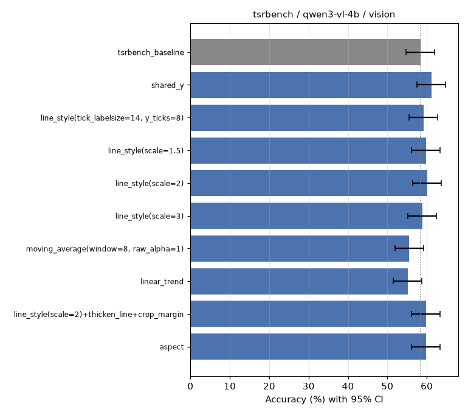
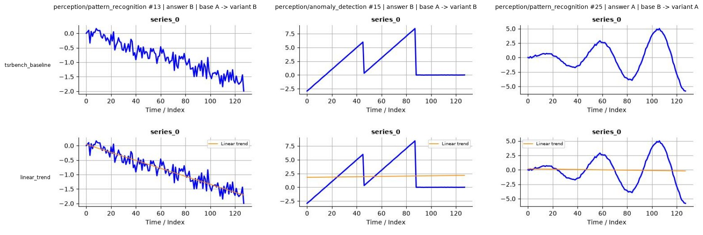
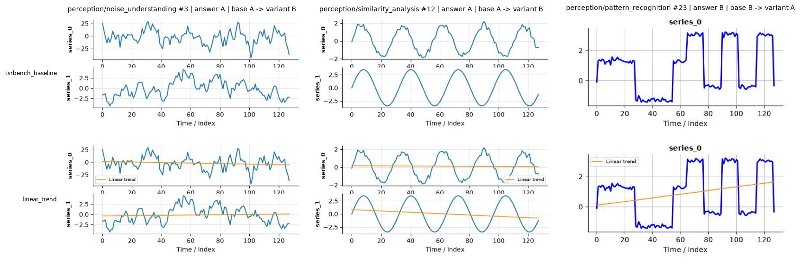
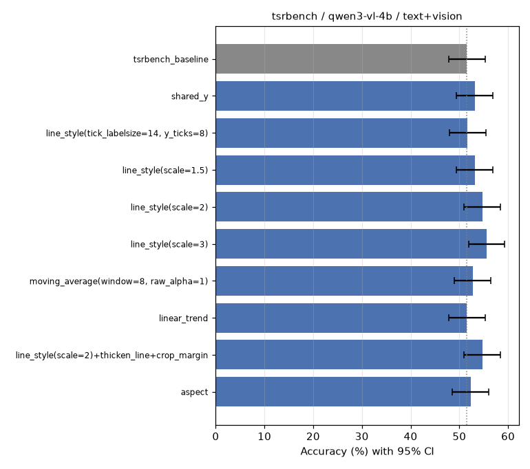
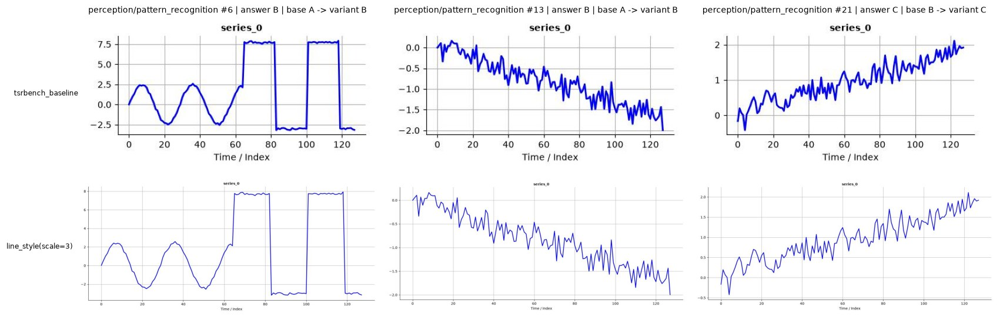
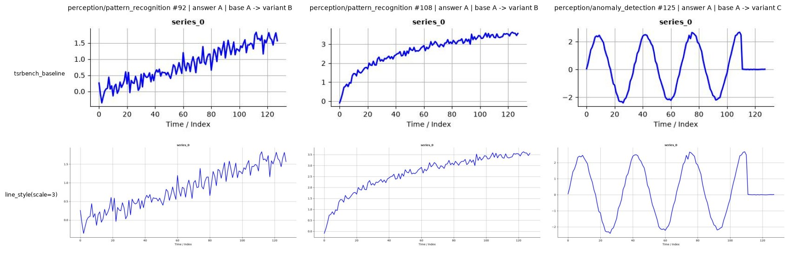
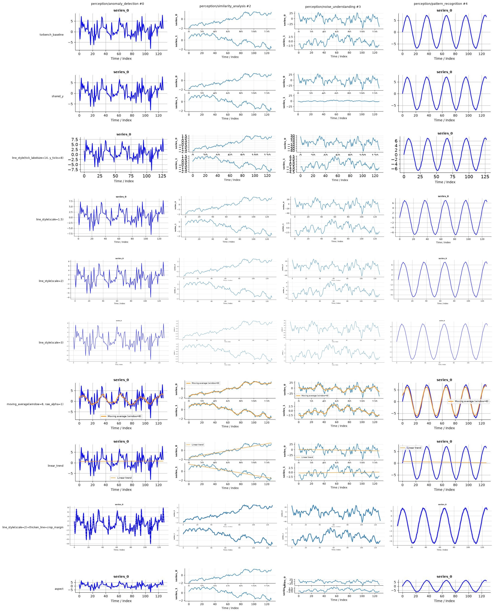

# 실험 보고서: perception_augment_next

perception 추가 증강 (공유 y축, 눈금, 해상도, 추세선, 합치기, 기울기)

- 생성: 2026-11-18T06:26:55+00:00
- 진행: 14000 / 14000 요청 완료 (100.0%)
- 대상: tsrbench/perception | 모델: qwen3-vl-4b | 입력: vision, text+vision
- sampling: `official`, repeats 1, max_tokens 없음(공식), text 값 간격 1
- 비교 기준(baseline): `tsrbench_baseline`

읽는 법

- 정확도: 처리가 끝난 문항 중 정답 비율. 답 글자를 못 뽑은 응답과 context 초과 문항은 오답으로 친다. 대괄호는 95% 신뢰구간.
- 공식 방식: TSRBench 공식 채점처럼 JSON 으로 읽히지 않은 응답을 분모에서 뺀 값.
- 차이: 같은 문항끼리 baseline 과 비교한 값(%p). 얻음/잃음 = baseline 에서 틀렸다가 맞은 / 맞았다가 틀린 문항 수.
- p: McNemar exact test. p(Holm) 은 같은 표 안의 여러 비교를 보정한 값이다.

## tsrbench / qwen3-vl-4b / vision

| chart | 문항 수 | 정확도 % [95% CI] | 차이 %p [95% CI] | 얻음 / 잃음 | p | p (Holm) | 공식 방식 % | 답 없음 | 처리율 |
| --- | --- | --- | --- | --- | --- | --- | --- | --- | --- |
| **tsrbench_baseline** (baseline) | 700 | 58.4 [54.7, 62.0] |  |  |  |  | 58.7 | 3 | 100% |
| shared_y | 700 | 61.1 [57.5, 64.7] | +2.7 [-0.1, 5.6] | 62 / 43 | 0.078 | 0.692 | 61.4 | 3 | 100% |
| line_style(tick_labelsize=14, y_ticks=8) | 700 | 59.1 [55.5, 62.7] | +0.7 [-2.5, 3.9] | 69 / 64 | 0.729 | 1.000 | 59.1 | 0 | 100% |
| line_style(scale=1.5) | 700 | 59.9 [56.2, 63.4] | +1.4 [-2.0, 4.8] | 78 / 68 | 0.456 | 1.000 | 59.9 | 0 | 100% |
| line_style(scale=2) | 700 | 60.1 [56.5, 63.7] | +1.7 [-1.6, 5.0] | 75 / 63 | 0.349 | 1.000 | 60.1 | 0 | 100% |
| line_style(scale=3) | 700 | 58.9 [55.2, 62.4] | +0.4 [-2.9, 3.8] | 74 / 71 | 0.868 | 1.000 | 58.9 | 0 | 100% |
| moving_average(window=8, raw_alpha=1) | 700 | 55.6 [51.9, 59.2] | -2.9 [-6.5, 0.8] | 77 / 97 | 0.150 | 1.000 | 55.7 | 1 | 100% |
| linear_trend | 700 | 55.1 [51.4, 58.8] | -3.3 [-6.8, 0.2] | 66 / 89 | 0.077 | 0.692 | 55.1 | 0 | 100% |
| line_style(scale=2)+thicken_line+crop_margin | 700 | 59.9 [56.2, 63.4] | +1.4 [-1.9, 4.8] | 76 / 66 | 0.450 | 1.000 | 59.9 | 0 | 100% |
| aspect | 700 | 59.9 [56.2, 63.4] | +1.4 [-1.8, 4.7] | 72 / 62 | 0.437 | 1.000 | 60.2 | 4 | 100% |

기준선: 최빈 정답(A)만 찍으면 42.6%

### task 별 정확도 % (괄호: baseline 대비 %p)

| task | 문항 | tsrbench_baseline | shared_y | line_style(tick_labelsize=14, y_ticks=8) | line_style(scale=1.5) | line_style(scale=2) | line_style(scale=3) | moving_average(window=8, raw_alpha=1) | linear_trend | line_style(scale=2)+thicken_line+crop_margin | aspect |
| --- | --- | --- | --- | --- | --- | --- | --- | --- | --- | --- | --- |
| perception/anomaly_detection | 129 | 49.6 | 48.1 (-1.6) | 46.5 (-3.1) | 55.0 (+5.4) | 55.0 (+5.4) | 50.4 (+0.8) | 49.6 (+0.0) | 51.2 (+1.6) | 51.9 (+2.3) | 49.6 (+0.0) |
| perception/noise_understanding | 87 | 52.9 | 62.1 (+9.2) | 51.7 (-1.1) | 50.6 (-2.3) | 48.3 (-4.6) | 58.6 (+5.7) | 44.8 (-8.0) | 42.5 (-10.3) | 55.2 (+2.3) | 59.8 (+6.9) |
| perception/pattern_recognition | 371 | 61.2 | 61.7 (+0.5) | 64.7 (+3.5) | 62.5 (+1.3) | 63.3 (+2.2) | 59.8 (-1.3) | 59.6 (-1.6) | 57.1 (-4.0) | 62.3 (+1.1) | 60.1 (-1.1) |
| perception/similarity_analysis | 113 | 63.7 | 73.5 (+9.7) | 61.1 (-2.7) | 63.7 (+0.0) | 64.6 (+0.9) | 65.5 (+1.8) | 57.5 (-6.2) | 62.8 (-0.9) | 64.6 (+0.9) | 70.8 (+7.1) |

### baseline 과 정오가 바뀐 문항

- `shared_y`: 얻음 62 (예: perception#5, perception#19, perception#24, perception#25, perception#43) / 잃음 43 (예: perception#7, perception#12, perception#23, perception#53, perception#92)
- `line_style(tick_labelsize=14, y_ticks=8)`: 얻음 69 (예: perception#5, perception#13, perception#15, perception#19, perception#43) / 잃음 64 (예: perception#10, perception#12, perception#17, perception#23, perception#28)
- `line_style(scale=1.5)`: 얻음 78 (예: perception#5, perception#15, perception#19, perception#43, perception#41) / 잃음 68 (예: perception#7, perception#12, perception#38, perception#52, perception#53)
- `line_style(scale=2)`: 얻음 75 (예: perception#13, perception#15, perception#43, perception#39, perception#45) / 잃음 63 (예: perception#3, perception#10, perception#12, perception#17, perception#22)
- `line_style(scale=3)`: 얻음 74 (예: perception#15, perception#19, perception#25, perception#43, perception#41) / 잃음 71 (예: perception#10, perception#12, perception#17, perception#23, perception#52)
- `moving_average(window=8, raw_alpha=1)`: 얻음 77 (예: perception#5, perception#13, perception#14, perception#15, perception#19) / 잃음 97 (예: perception#3, perception#12, perception#17, perception#23, perception#36)
- `linear_trend`: 얻음 66 (예: perception#13, perception#15, perception#25, perception#41, perception#39) / 잃음 89 (예: perception#3, perception#12, perception#23, perception#38, perception#55)
- `line_style(scale=2)+thicken_line+crop_margin`: 얻음 76 (예: perception#5, perception#13, perception#15, perception#19, perception#33) / 잃음 66 (예: perception#1, perception#12, perception#17, perception#22, perception#23)
- `aspect`: 얻음 72 (예: perception#5, perception#15, perception#19, perception#30, perception#43) / 잃음 62 (예: perception#7, perception#10, perception#12, perception#17, perception#23)

`linear_trend` 에서 틀림 -> 맞음 인 문항 (위: baseline, 아래: 변형)

`linear_trend` 에서 맞음 -> 틀림 인 문항 (위: baseline, 아래: 변형)

### 비용과 입력 크기

| chart | 입력 tok | 출력 tok | 응답 시간 s (중앙값) | 이미지 수 | 이미지 px (최빈) | 이미지 KB | 재요청 | 길이 한도로 잘림 | 오류 | context 초과 |
| --- | --- | --- | --- | --- | --- | --- | --- | --- | --- | --- |
| tsrbench_baseline | 244 | 325 | 1.3 | 1.0 | 438x236 | 17 | 23 | 3 | 0 | 0 |
| shared_y | 244 | 348 | 1.3 | 1.0 | 438x236 | 17 | 25 | 3 | 0 | 0 |
| line_style(tick_labelsize=14, y_ticks=8) | 256 | 297 | 1.3 | 1.0 | 463x242 | 21 | 21 | 0 | 0 | 0 |
| line_style(scale=1.5) | 353 | 332 | 1.3 | 1.0 | 631x313 | 27 | 24 | 0 | 0 | 0 |
| line_style(scale=2) | 481 | 295 | 1.4 | 1.0 | 825x390 | 38 | 19 | 0 | 0 | 0 |
| line_style(scale=3) | 866 | 277 | 1.5 | 1.0 | 1213x544 | 60 | 19 | 0 | 0 | 0 |
| moving_average(window=8, raw_alpha=1) | 244 | 345 | 1.4 | 1.0 | 438x236 | 19 | 23 | 1 | 0 | 0 |
| linear_trend | 244 | 363 | 1.3 | 1.0 | 438x236 | 18 | 28 | 0 | 0 | 0 |
| line_style(scale=2)+thicken_line+crop_margin | 479 | 285 | 1.3 | 1.0 | 819x380 | 123 | 19 | 0 | 0 | 0 |
| aspect | 227 | 394 | 1.3 | 1.0 | 438x136 | 13 | 31 | 4 | 0 | 0 |

## tsrbench / qwen3-vl-4b / text+vision

| chart | 문항 수 | 정확도 % [95% CI] | 차이 %p [95% CI] | 얻음 / 잃음 | p | p (Holm) | 공식 방식 % | 답 없음 | 처리율 |
| --- | --- | --- | --- | --- | --- | --- | --- | --- | --- |
| **tsrbench_baseline** (baseline) | 700 | 51.6 [47.9, 55.3] |  |  |  |  | 51.6 | 0 | 100% |
| shared_y | 700 | 53.1 [49.4, 56.8] | +1.6 [-0.5, 3.6] | 32 / 21 | 0.169 | 1.000 | 53.1 | 0 | 100% |
| line_style(tick_labelsize=14, y_ticks=8) | 700 | 51.7 [48.0, 55.4] | +0.1 [-2.0, 2.3] | 30 / 29 | 1.000 | 1.000 | 51.7 | 0 | 100% |
| line_style(scale=1.5) | 700 | 53.1 [49.4, 56.8] | +1.6 [-0.8, 3.9] | 40 / 29 | 0.228 | 1.000 | 53.1 | 0 | 100% |
| line_style(scale=2) | 700 | 54.7 [51.0, 58.4] | +3.1 [0.8, 5.5] | 46 / 24 | 0.012 | 0.092 | 54.7 | 0 | 100% |
| line_style(scale=3) | 700 | 55.6 [51.9, 59.2] | +4.0 [1.5, 6.5] | 53 / 25 | 0.002 | 0.018 | 55.6 | 0 | 100% |
| moving_average(window=8, raw_alpha=1) | 700 | 52.7 [49.0, 56.4] | +1.1 [-1.2, 3.5] | 38 / 30 | 0.396 | 1.000 | 52.7 | 0 | 100% |
| linear_trend | 700 | 51.6 [47.9, 55.3] | +0.0 [-2.3, 2.3] | 33 / 33 | 1.000 | 1.000 | 51.6 | 0 | 100% |
| line_style(scale=2)+thicken_line+crop_margin | 700 | 54.7 [51.0, 58.4] | +3.1 [0.7, 5.6] | 50 / 28 | 0.017 | 0.118 | 54.7 | 0 | 100% |
| aspect | 700 | 52.3 [48.6, 56.0] | +0.7 [-1.8, 3.2] | 42 / 37 | 0.653 | 1.000 | 52.3 | 0 | 100% |

기준선: 최빈 정답(A)만 찍으면 42.6%

### task 별 정확도 % (괄호: baseline 대비 %p)

| task | 문항 | tsrbench_baseline | shared_y | line_style(tick_labelsize=14, y_ticks=8) | line_style(scale=1.5) | line_style(scale=2) | line_style(scale=3) | moving_average(window=8, raw_alpha=1) | linear_trend | line_style(scale=2)+thicken_line+crop_margin | aspect |
| --- | --- | --- | --- | --- | --- | --- | --- | --- | --- | --- | --- |
| perception/anomaly_detection | 129 | 43.4 | 45.0 (+1.6) | 43.4 (+0.0) | 41.9 (-1.6) | 46.5 (+3.1) | 46.5 (+3.1) | 44.2 (+0.8) | 41.9 (-1.6) | 46.5 (+3.1) | 41.1 (-2.3) |
| perception/noise_understanding | 87 | 49.4 | 49.4 (+0.0) | 48.3 (-1.1) | 49.4 (+0.0) | 51.7 (+2.3) | 49.4 (+0.0) | 48.3 (-1.1) | 49.4 (+0.0) | 50.6 (+1.1) | 50.6 (+1.1) |
| perception/pattern_recognition | 371 | 54.4 | 55.5 (+1.1) | 54.7 (+0.3) | 57.1 (+2.7) | 57.1 (+2.7) | 58.2 (+3.8) | 54.7 (+0.3) | 54.2 (-0.3) | 57.1 (+2.7) | 55.5 (+1.1) |
| perception/similarity_analysis | 113 | 53.1 | 57.5 (+4.4) | 54.0 (+0.9) | 55.8 (+2.7) | 58.4 (+5.3) | 61.9 (+8.8) | 59.3 (+6.2) | 55.8 (+2.7) | 59.3 (+6.2) | 55.8 (+2.7) |

### baseline 과 정오가 바뀐 문항

- `shared_y`: 얻음 32 (예: perception#1, perception#6, perception#45, perception#47, perception#49) / 잃음 21 (예: perception#32, perception#157, perception#175, perception#200, perception#203)
- `line_style(tick_labelsize=14, y_ticks=8)`: 얻음 30 (예: perception#0, perception#6, perception#13, perception#21, perception#45) / 잃음 29 (예: perception#84, perception#108, perception#124, perception#148, perception#175)
- `line_style(scale=1.5)`: 얻음 40 (예: perception#0, perception#6, perception#13, perception#24, perception#49) / 잃음 29 (예: perception#32, perception#124, perception#141, perception#148, perception#175)
- `line_style(scale=2)`: 얻음 46 (예: perception#0, perception#6, perception#13, perception#21, perception#45) / 잃음 24 (예: perception#125, perception#124, perception#148, perception#175, perception#219)
- `line_style(scale=3)`: 얻음 53 (예: perception#6, perception#13, perception#21, perception#49, perception#50) / 잃음 25 (예: perception#92, perception#108, perception#125, perception#124, perception#175)
- `moving_average(window=8, raw_alpha=1)`: 얻음 38 (예: perception#0, perception#5, perception#6, perception#13, perception#45) / 잃음 30 (예: perception#41, perception#108, perception#125, perception#124, perception#143)
- `linear_trend`: 얻음 33 (예: perception#0, perception#6, perception#13, perception#24, perception#75) / 잃음 33 (예: perception#37, perception#84, perception#108, perception#142, perception#175)
- `line_style(scale=2)+thicken_line+crop_margin`: 얻음 50 (예: perception#0, perception#49, perception#53, perception#50, perception#51) / 잃음 28 (예: perception#84, perception#108, perception#125, perception#124, perception#126)
- `aspect`: 얻음 42 (예: perception#6, perception#13, perception#24, perception#49, perception#50) / 잃음 37 (예: perception#10, perception#32, perception#84, perception#108, perception#124)

`line_style(scale=3)` 에서 틀림 -> 맞음 인 문항 (위: baseline, 아래: 변형)

`line_style(scale=3)` 에서 맞음 -> 틀림 인 문항 (위: baseline, 아래: 변형)

### 비용과 입력 크기

| chart | 입력 tok | 출력 tok | 응답 시간 s (중앙값) | 이미지 수 | 이미지 px (최빈) | 이미지 KB | 재요청 | 길이 한도로 잘림 | 오류 | context 초과 |
| --- | --- | --- | --- | --- | --- | --- | --- | --- | --- | --- |
| tsrbench_baseline | 1288 | 14 | 0.5 | 1.0 | 438x236 | 17 | 0 | 0 | 0 | 0 |
| shared_y | 1288 | 14 | 0.4 | 1.0 | 438x236 | 17 | 0 | 0 | 0 | 0 |
| line_style(tick_labelsize=14, y_ticks=8) | 1300 | 14 | 0.4 | 1.0 | 463x242 | 21 | 0 | 0 | 0 | 0 |
| line_style(scale=1.5) | 1396 | 14 | 0.5 | 1.0 | 631x313 | 27 | 0 | 0 | 0 | 0 |
| line_style(scale=2) | 1525 | 14 | 0.5 | 1.0 | 825x390 | 38 | 0 | 0 | 0 | 0 |
| line_style(scale=3) | 1909 | 14 | 0.7 | 1.0 | 1213x544 | 60 | 0 | 0 | 0 | 0 |
| moving_average(window=8, raw_alpha=1) | 1288 | 14 | 0.4 | 1.0 | 438x236 | 19 | 0 | 0 | 0 | 0 |
| linear_trend | 1288 | 14 | 0.4 | 1.0 | 438x236 | 18 | 0 | 0 | 0 | 0 |
| line_style(scale=2)+thicken_line+crop_margin | 1523 | 14 | 0.5 | 1.0 | 819x380 | 123 | 0 | 0 | 0 | 0 |
| aspect | 1271 | 14 | 0.4 | 1.0 | 438x136 | 13 | 0 | 0 | 0 | 0 |

## chart 예시

같은 문항을 chart 별로 그린 것 (행 = chart, 열 = 문항).

### perception

## 실행 환경과 설정

| model | 이름 | 서빙 설정 | 보낸 sampling | 서버 기본 sampling |
| --- | --- | --- | --- | --- |
| qwen3-vl-4b | Qwen/Qwen3-VL-4B-Instruct | dtype=float16, limit_mm_per_prompt={'image': 4}, revision=ebb281ec70b05090aa6165b016eac8ec08e71b17 | 없음 (서버 기본값 사용) | {'do_sample': True, 'temperature': 0.7, 'top_p': 0.8, 'top_k': 20, 'repetition_penalty': 1.0} |

- OS Linux 6.8.0-147-generic, Python 3.12.16, CPU Intel(R) Core(TM) Ultra 7 270K Plus (24 threads), RAM 62.1 GB
- GPU: NVIDIA GeForce RTX 5090 32GB | Colab: 아니오
- 패키지: matplotlib 3.11.2, pillow 13.0.0, numpy 2.5.4, openai 3.49.0, huggingface_hub 2.4.0, PyYAML 6.0.3, rich 15.0.0
- git commit: a6b8b573

run 폴더 (raw 결과)

- `runs/tsrbench/perception/qwen3-vl-4b/vision/tsrbench_baseline__5357ce0e` : tsrbench/perception | qwen3-vl-4b | vision | tsrbench_baseline
- `runs/tsrbench/perception/qwen3-vl-4b/vision/shared_y__57bd5598` : tsrbench/perception | qwen3-vl-4b | vision | shared_y
- `runs/tsrbench/perception/qwen3-vl-4b/vision/line_style-tick_labelsize14-y_ticks8__fe1b8775` : tsrbench/perception | qwen3-vl-4b | vision | line_style(tick_labelsize=14, y_ticks=8)
- `runs/tsrbench/perception/qwen3-vl-4b/vision/line_style-scale1.5__6644b052` : tsrbench/perception | qwen3-vl-4b | vision | line_style(scale=1.5)
- `runs/tsrbench/perception/qwen3-vl-4b/vision/line_style-scale2__cc60431a` : tsrbench/perception | qwen3-vl-4b | vision | line_style(scale=2)
- `runs/tsrbench/perception/qwen3-vl-4b/vision/line_style-scale3__4cb598de` : tsrbench/perception | qwen3-vl-4b | vision | line_style(scale=3)
- `runs/tsrbench/perception/qwen3-vl-4b/vision/moving_average-window8-raw_alpha1__c5c5f1cc` : tsrbench/perception | qwen3-vl-4b | vision | moving_average(window=8, raw_alpha=1)
- `runs/tsrbench/perception/qwen3-vl-4b/vision/linear_trend__da7aea72` : tsrbench/perception | qwen3-vl-4b | vision | linear_trend
- `runs/tsrbench/perception/qwen3-vl-4b/vision/line_style-scale2+thicken_line+crop_margin__f0f15ca2` : tsrbench/perception | qwen3-vl-4b | vision | line_style(scale=2)+thicken_line+crop_margin
- `runs/tsrbench/perception/qwen3-vl-4b/vision/aspect__ddc6e087` : tsrbench/perception | qwen3-vl-4b | vision | aspect
- `runs/tsrbench/perception/qwen3-vl-4b/text+vision/tsrbench_baseline__210a1cd1` : tsrbench/perception | qwen3-vl-4b | text+vision | tsrbench_baseline
- `runs/tsrbench/perception/qwen3-vl-4b/text+vision/shared_y__4f30db51` : tsrbench/perception | qwen3-vl-4b | text+vision | shared_y
- `runs/tsrbench/perception/qwen3-vl-4b/text+vision/line_style-tick_labelsize14-y_ticks8__2f8e02e8` : tsrbench/perception | qwen3-vl-4b | text+vision | line_style(tick_labelsize=14, y_ticks=8)
- `runs/tsrbench/perception/qwen3-vl-4b/text+vision/line_style-scale1.5__4c478ca7` : tsrbench/perception | qwen3-vl-4b | text+vision | line_style(scale=1.5)
- `runs/tsrbench/perception/qwen3-vl-4b/text+vision/line_style-scale2__1ec4aaec` : tsrbench/perception | qwen3-vl-4b | text+vision | line_style(scale=2)
- `runs/tsrbench/perception/qwen3-vl-4b/text+vision/line_style-scale3__35d96296` : tsrbench/perception | qwen3-vl-4b | text+vision | line_style(scale=3)
- `runs/tsrbench/perception/qwen3-vl-4b/text+vision/moving_average-window8-raw_alpha1__3218fb94` : tsrbench/perception | qwen3-vl-4b | text+vision | moving_average(window=8, raw_alpha=1)
- `runs/tsrbench/perception/qwen3-vl-4b/text+vision/linear_trend__340b53ab` : tsrbench/perception | qwen3-vl-4b | text+vision | linear_trend
- `runs/tsrbench/perception/qwen3-vl-4b/text+vision/line_style-scale2+thicken_line+crop_margin__973b6ee9` : tsrbench/perception | qwen3-vl-4b | text+vision | line_style(scale=2)+thicken_line+crop_margin
- `runs/tsrbench/perception/qwen3-vl-4b/text+vision/aspect__be20f9bb` : tsrbench/perception | qwen3-vl-4b | text+vision | aspect

