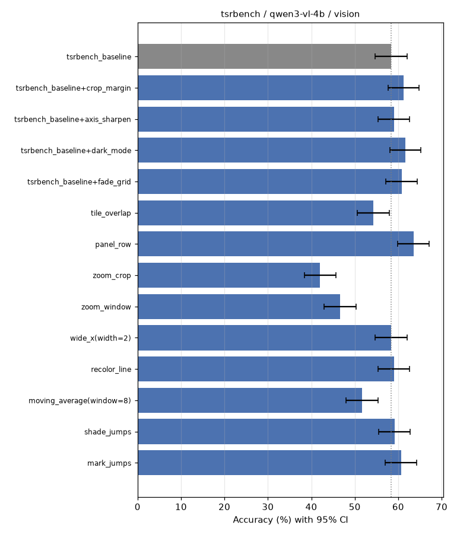
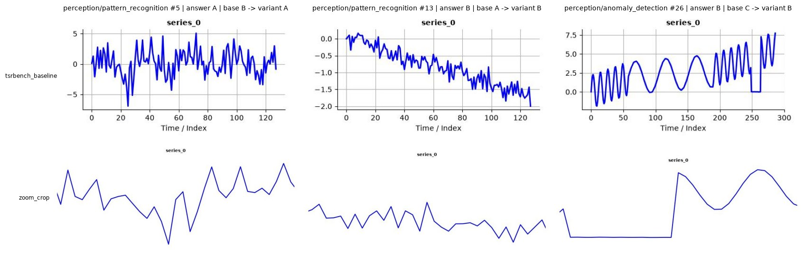
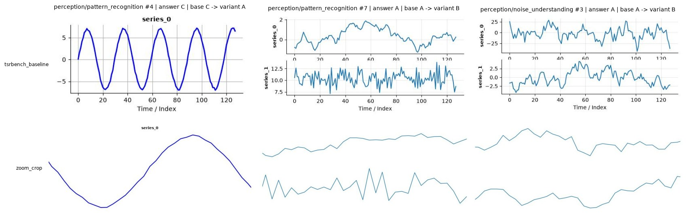
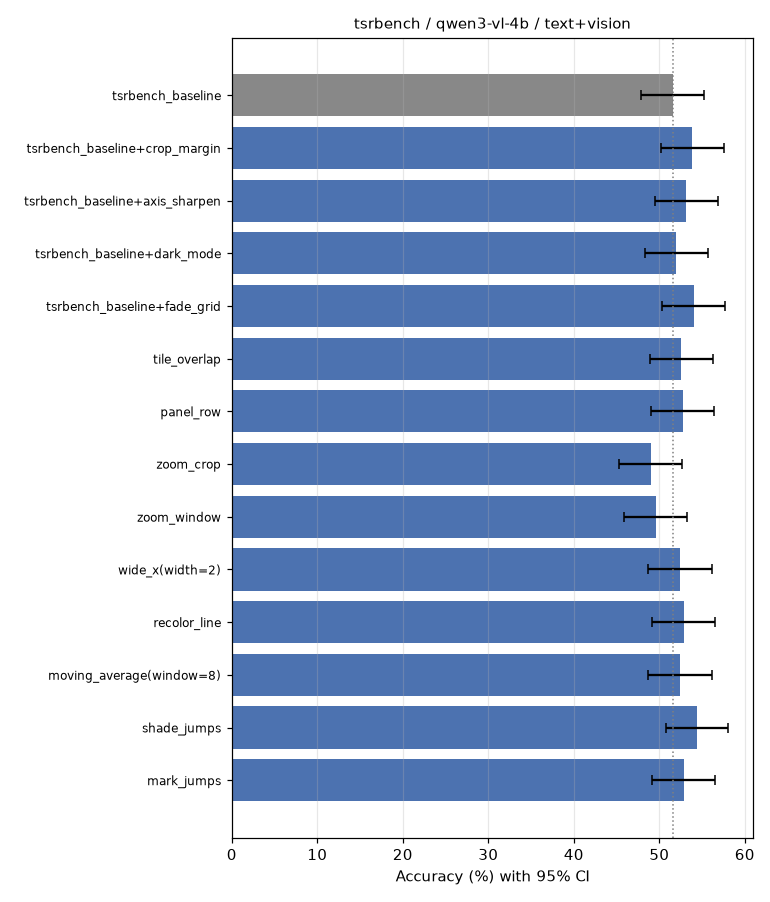
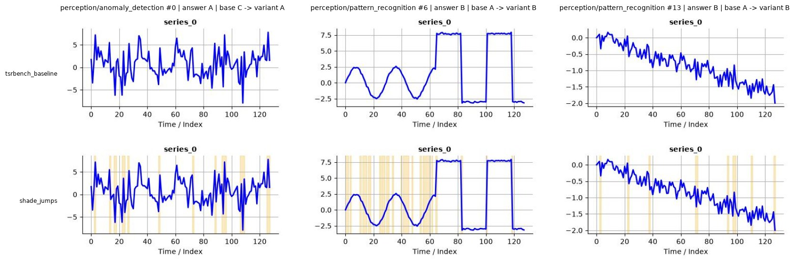
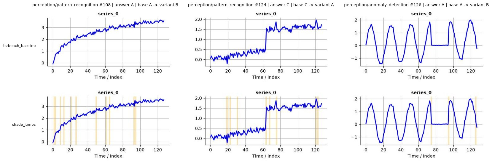
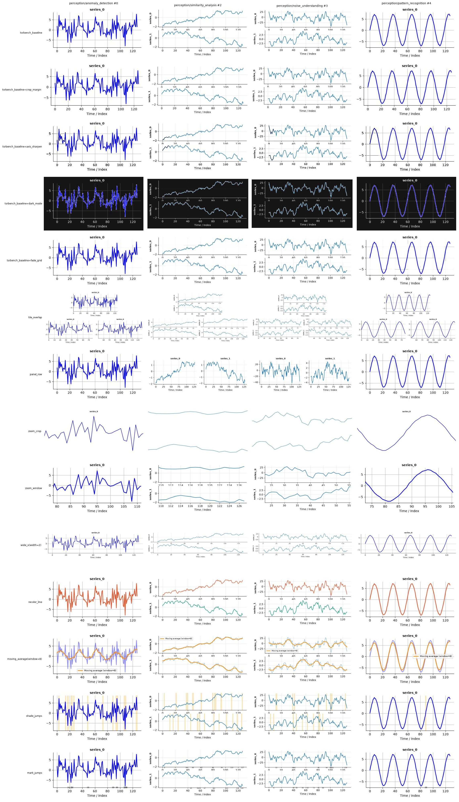

# 실험 보고서: perception_augment_sy

perception chart 이미지 보정 비교

- 생성: 2026-11-16T01:01:06+00:00
- 진행: 19600 / 19600 요청 완료 (100.0%)
- 대상: tsrbench/perception | 모델: qwen3-vl-4b | 입력: vision, text+vision
- sampling: `official`, repeats 1, max_tokens 없음(공식), text 값 간격 1
- 비교 기준(baseline): `tsrbench_baseline`

읽는 법

- 정확도: 처리가 끝난 문항 중 정답 비율. 답 글자를 못 뽑은 응답과 context 초과 문항은 오답으로 친다. 대괄호는 95% 신뢰구간.
- 공식 방식: TSRBench 공식 채점처럼 JSON 으로 읽히지 않은 응답을 분모에서 뺀 값.
- 차이: 같은 문항끼리 baseline 과 비교한 값(%p). 얻음/잃음 = baseline 에서 틀렸다가 맞은 / 맞았다가 틀린 문항 수.
- p: McNemar exact test. p(Holm) 은 같은 표 안의 여러 비교를 보정한 값이다.

## tsrbench / qwen3-vl-4b / vision

| chart | 문항 수 | 정확도 % [95% CI] | 차이 %p [95% CI] | 얻음 / 잃음 | p | p (Holm) | 공식 방식 % | 답 없음 | 처리율 |
| --- | --- | --- | --- | --- | --- | --- | --- | --- | --- |
| **tsrbench_baseline** (baseline) | 700 | 58.4 [54.7, 62.0] |  |  |  |  | 58.7 | 3 | 100% |
| tsrbench_baseline+crop_margin | 700 | 61.3 [57.6, 64.8] | +2.9 [-0.1, 5.8] | 65 / 45 | 0.070 | 0.487 | 61.3 | 0 | 100% |
| tsrbench_baseline+axis_sharpen | 700 | 59.0 [55.3, 62.6] | +0.6 [-2.1, 3.2] | 46 / 42 | 0.749 | 1.000 | 59.3 | 4 | 100% |
| tsrbench_baseline+dark_mode | 700 | 61.7 [58.1, 65.2] | +3.3 [0.3, 6.3] | 70 / 47 | 0.042 | 0.332 | 61.9 | 2 | 100% |
| tsrbench_baseline+fade_grid | 700 | 60.9 [57.2, 64.4] | +2.4 [-0.4, 5.2] | 58 / 41 | 0.107 | 0.644 | 60.9 | 1 | 100% |
| tile_overlap | 700 | 54.3 [50.6, 57.9] | -4.1 [-7.7, -0.6] | 66 / 95 | 0.027 | 0.243 | 54.4 | 2 | 100% |
| panel_row | 700 | 63.6 [59.9, 67.1] | +5.1 [2.2, 8.1] | 75 / 39 | <0.001 | 0.010 | 63.9 | 4 | 100% |
| zoom_crop | 700 | 42.0 [38.4, 45.7] | -16.4 [-20.6, -12.3] | 63 / 178 | <0.001 | <0.001 | 42.0 | 0 | 100% |
| zoom_window | 700 | 46.6 [42.9, 50.3] | -11.9 [-15.7, -8.0] | 56 / 139 | <0.001 | <0.001 | 46.6 | 1 | 100% |
| wide_x(width=2) | 700 | 58.4 [54.7, 62.0] | +0.0 [-3.2, 3.2] | 64 / 64 | 1.000 | 1.000 | 58.6 | 2 | 100% |
| recolor_line | 700 | 59.0 [55.3, 62.6] | +0.6 [-2.4, 3.5] | 57 / 53 | 0.775 | 1.000 | 59.2 | 2 | 100% |
| moving_average(window=8) | 700 | 51.7 [48.0, 55.4] | -6.7 [-10.5, -2.9] | 69 / 116 | <0.001 | 0.007 | 51.8 | 1 | 100% |
| shade_jumps | 700 | 59.1 [55.5, 62.7] | +0.7 [-2.7, 4.1] | 75 / 70 | 0.740 | 1.000 | 59.2 | 1 | 100% |
| mark_jumps | 700 | 60.7 [57.0, 64.3] | +2.3 [-0.7, 5.2] | 64 / 48 | 0.156 | 0.780 | 60.9 | 2 | 100% |

기준선: 최빈 정답(A)만 찍으면 42.6%

### task 별 정확도 % (괄호: baseline 대비 %p)

| task | 문항 | tsrbench_baseline | tsrbench_baseline+crop_margin | tsrbench_baseline+axis_sharpen | tsrbench_baseline+dark_mode | tsrbench_baseline+fade_grid | tile_overlap | panel_row | zoom_crop | zoom_window | wide_x(width=2) | recolor_line | moving_average(window=8) | shade_jumps | mark_jumps |
| --- | --- | --- | --- | --- | --- | --- | --- | --- | --- | --- | --- | --- | --- | --- | --- |
| perception/anomaly_detection | 129 | 49.6 | 51.9 (+2.3) | 52.7 (+3.1) | 51.2 (+1.6) | 51.2 (+1.6) | 45.7 (-3.9) | 56.6 (+7.0) | 45.0 (-4.7) | 45.7 (-3.9) | 54.3 (+4.7) | 51.2 (+1.6) | 38.8 (-10.9) | 50.4 (+0.8) | 52.7 (+3.1) |
| perception/noise_understanding | 87 | 52.9 | 56.3 (+3.4) | 57.5 (+4.6) | 59.8 (+6.9) | 50.6 (-2.3) | 55.2 (+2.3) | 57.5 (+4.6) | 40.2 (-12.6) | 41.4 (-11.5) | 49.4 (-3.4) | 58.6 (+5.7) | 44.8 (-8.0) | 52.9 (+0.0) | 52.9 (+0.0) |
| perception/pattern_recognition | 371 | 61.2 | 64.7 (+3.5) | 59.3 (-1.9) | 65.2 (+4.0) | 65.0 (+3.8) | 57.7 (-3.5) | 63.9 (+2.7) | 39.1 (-22.1) | 44.2 (-17.0) | 60.9 (-0.3) | 62.0 (+0.8) | 55.8 (-5.4) | 62.0 (+0.8) | 63.9 (+2.7) |
| perception/similarity_analysis | 113 | 63.7 | 64.6 (+0.9) | 66.4 (+2.7) | 63.7 (+0.0) | 66.4 (+2.7) | 52.2 (-11.5) | 75.2 (+11.5) | 49.6 (-14.2) | 59.3 (-4.4) | 61.9 (-1.8) | 58.4 (-5.3) | 58.4 (-5.3) | 64.6 (+0.9) | 65.5 (+1.8) |

### baseline 과 정오가 바뀐 문항

- `tsrbench_baseline+crop_margin`: 얻음 65 (예: perception#5, perception#13, perception#20, perception#19, perception#43) / 잃음 45 (예: perception#12, perception#28, perception#92, perception#126, perception#154)
- `tsrbench_baseline+axis_sharpen`: 얻음 46 (예: perception#5, perception#15, perception#48, perception#62, perception#81) / 잃음 42 (예: perception#12, perception#23, perception#29, perception#38, perception#55)
- `tsrbench_baseline+dark_mode`: 얻음 70 (예: perception#13, perception#15, perception#24, perception#43, perception#45) / 잃음 47 (예: perception#12, perception#52, perception#55, perception#65, perception#92)
- `tsrbench_baseline+fade_grid`: 얻음 58 (예: perception#5, perception#13, perception#15, perception#19, perception#25) / 잃음 41 (예: perception#1, perception#12, perception#28, perception#65, perception#92)
- `tile_overlap`: 얻음 66 (예: perception#5, perception#19, perception#43, perception#39, perception#45) / 잃음 95 (예: perception#7, perception#12, perception#17, perception#23, perception#52)
- `panel_row`: 얻음 75 (예: perception#5, perception#15, perception#19, perception#43, perception#40) / 잃음 39 (예: perception#12, perception#38, perception#55, perception#92, perception#93)
- `zoom_crop`: 얻음 63 (예: perception#5, perception#13, perception#26, perception#41, perception#39) / 잃음 178 (예: perception#4, perception#7, perception#3, perception#10, perception#12)
- `zoom_window`: 얻음 56 (예: perception#19, perception#49, perception#58, perception#79, perception#100) / 잃음 139 (예: perception#7, perception#10, perception#12, perception#6, perception#23)
- `wide_x(width=2)`: 얻음 64 (예: perception#5, perception#13, perception#15, perception#43, perception#41) / 잃음 64 (예: perception#12, perception#17, perception#22, perception#23, perception#53)
- `recolor_line`: 얻음 57 (예: perception#5, perception#19, perception#25, perception#30, perception#43) / 잃음 53 (예: perception#1, perception#10, perception#12, perception#22, perception#29)
- `moving_average(window=8)`: 얻음 69 (예: perception#5, perception#13, perception#19, perception#25, perception#43) / 잃음 116 (예: perception#9, perception#3, perception#17, perception#23, perception#27)
- `shade_jumps`: 얻음 75 (예: perception#5, perception#13, perception#15, perception#19, perception#25) / 잃음 70 (예: perception#7, perception#12, perception#22, perception#23, perception#93)
- `mark_jumps`: 얻음 64 (예: perception#15, perception#19, perception#25, perception#30, perception#43) / 잃음 48 (예: perception#12, perception#22, perception#52, perception#53, perception#55)

`zoom_crop` 에서 틀림 -> 맞음 인 문항 (위: baseline, 아래: 변형)

`zoom_crop` 에서 맞음 -> 틀림 인 문항 (위: baseline, 아래: 변형)

### 비용과 입력 크기

| chart | 입력 tok | 출력 tok | 응답 시간 s (중앙값) | 이미지 수 | 이미지 px (최빈) | 이미지 KB | 재요청 | 길이 한도로 잘림 | 오류 | context 초과 |
| --- | --- | --- | --- | --- | --- | --- | --- | --- | --- | --- |
| tsrbench_baseline | 244 | 325 | 1.3 | 1.0 | 438x236 | 17 | 23 | 3 | 0 | 0 |
| tsrbench_baseline+crop_margin | 240 | 276 | 1.2 | 1.0 | 426x221 | 63 | 18 | 0 | 0 | 0 |
| tsrbench_baseline+axis_sharpen | 244 | 373 | 1.3 | 1.0 | 438x236 | 56 | 32 | 4 | 0 | 0 |
| tsrbench_baseline+dark_mode | 244 | 262 | 1.2 | 1.0 | 438x236 | 39 | 14 | 2 | 0 | 0 |
| tsrbench_baseline+fade_grid | 244 | 305 | 1.2 | 1.0 | 438x236 | 63 | 22 | 1 | 0 | 0 |
| tile_overlap | 580 | 420 | 1.6 | 1.0 | 876x472 | 94 | 35 | 2 | 0 | 0 |
| panel_row | 245 | 263 | 1.3 | 1.0 | 438x236 | 17 | 13 | 4 | 0 | 0 |
| zoom_crop | 379 | 278 | 1.2 | 1.0 | 794x332 | 24 | 18 | 0 | 0 | 0 |
| zoom_window | 244 | 427 | 1.4 | 1.0 | 438x236 | 15 | 37 | 1 | 0 | 0 |
| wide_x(width=2) | 336 | 307 | 1.3 | 1.0 | 825x236 | 25 | 20 | 2 | 0 | 0 |
| recolor_line | 244 | 282 | 1.2 | 1.0 | 438x236 | 16 | 18 | 2 | 0 | 0 |
| moving_average(window=8) | 244 | 355 | 1.4 | 1.0 | 438x236 | 17 | 26 | 1 | 0 | 0 |
| shade_jumps | 244 | 313 | 1.3 | 1.0 | 438x236 | 18 | 21 | 1 | 0 | 0 |
| mark_jumps | 244 | 325 | 1.3 | 1.0 | 438x236 | 17 | 23 | 2 | 0 | 0 |

## tsrbench / qwen3-vl-4b / text+vision

| chart | 문항 수 | 정확도 % [95% CI] | 차이 %p [95% CI] | 얻음 / 잃음 | p | p (Holm) | 공식 방식 % | 답 없음 | 처리율 |
| --- | --- | --- | --- | --- | --- | --- | --- | --- | --- |
| **tsrbench_baseline** (baseline) | 700 | 51.6 [47.9, 55.3] |  |  |  |  | 51.6 | 0 | 100% |
| tsrbench_baseline+crop_margin | 700 | 53.9 [50.2, 57.5] | +2.3 [0.1, 4.5] | 39 / 23 | 0.056 | 0.615 | 53.9 | 0 | 100% |
| tsrbench_baseline+axis_sharpen | 700 | 53.1 [49.4, 56.8] | +1.6 [-0.5, 3.6] | 33 / 22 | 0.177 | 1.000 | 53.1 | 0 | 100% |
| tsrbench_baseline+dark_mode | 700 | 52.0 [48.3, 55.7] | +0.4 [-1.7, 2.6] | 31 / 28 | 0.795 | 1.000 | 52.0 | 0 | 100% |
| tsrbench_baseline+fade_grid | 700 | 54.0 [50.3, 57.7] | +2.4 [0.3, 4.5] | 37 / 20 | 0.033 | 0.398 | 54.0 | 0 | 100% |
| tile_overlap | 700 | 52.6 [48.9, 56.2] | +1.0 [-1.5, 3.5] | 43 / 36 | 0.500 | 1.000 | 52.6 | 0 | 100% |
| panel_row | 700 | 52.7 [49.0, 56.4] | +1.1 [-0.9, 3.2] | 30 / 22 | 0.332 | 1.000 | 52.7 | 0 | 100% |
| zoom_crop | 700 | 49.0 [45.3, 52.7] | -2.6 [-5.1, -0.0] | 33 / 51 | 0.063 | 0.630 | 49.0 | 0 | 100% |
| zoom_window | 700 | 49.6 [45.9, 53.3] | -2.0 [-4.6, 0.6] | 35 / 49 | 0.156 | 1.000 | 49.6 | 0 | 100% |
| wide_x(width=2) | 700 | 52.4 [48.7, 56.1] | +0.9 [-1.5, 3.2] | 39 / 33 | 0.556 | 1.000 | 52.4 | 0 | 100% |
| recolor_line | 700 | 52.9 [49.2, 56.5] | +1.3 [-0.9, 3.4] | 34 / 25 | 0.298 | 1.000 | 52.9 | 0 | 100% |
| moving_average(window=8) | 700 | 52.4 [48.7, 56.1] | +0.9 [-1.3, 3.1] | 34 / 28 | 0.526 | 1.000 | 52.4 | 0 | 100% |
| shade_jumps | 700 | 54.4 [50.7, 58.1] | +2.9 [0.5, 5.2] | 45 / 25 | 0.022 | 0.292 | 54.4 | 0 | 100% |
| mark_jumps | 700 | 52.9 [49.2, 56.5] | +1.3 [-0.8, 3.4] | 32 / 23 | 0.281 | 1.000 | 52.9 | 0 | 100% |

기준선: 최빈 정답(A)만 찍으면 42.6%

### task 별 정확도 % (괄호: baseline 대비 %p)

| task | 문항 | tsrbench_baseline | tsrbench_baseline+crop_margin | tsrbench_baseline+axis_sharpen | tsrbench_baseline+dark_mode | tsrbench_baseline+fade_grid | tile_overlap | panel_row | zoom_crop | zoom_window | wide_x(width=2) | recolor_line | moving_average(window=8) | shade_jumps | mark_jumps |
| --- | --- | --- | --- | --- | --- | --- | --- | --- | --- | --- | --- | --- | --- | --- | --- |
| perception/anomaly_detection | 129 | 43.4 | 46.5 (+3.1) | 45.0 (+1.6) | 47.3 (+3.9) | 48.1 (+4.7) | 41.9 (-1.6) | 44.2 (+0.8) | 43.4 (+0.0) | 44.2 (+0.8) | 44.2 (+0.8) | 44.2 (+0.8) | 41.1 (-2.3) | 48.8 (+5.4) | 41.9 (-1.6) |
| perception/noise_understanding | 87 | 49.4 | 46.0 (-3.4) | 50.6 (+1.1) | 49.4 (+0.0) | 52.9 (+3.4) | 48.3 (-1.1) | 50.6 (+1.1) | 48.3 (-1.1) | 47.1 (-2.3) | 49.4 (+0.0) | 50.6 (+1.1) | 47.1 (-2.3) | 48.3 (-1.1) | 48.3 (-1.1) |
| perception/pattern_recognition | 371 | 54.4 | 57.1 (+2.7) | 54.7 (+0.3) | 53.1 (-1.3) | 55.8 (+1.3) | 55.5 (+1.1) | 54.2 (-0.3) | 49.1 (-5.4) | 49.6 (-4.9) | 55.0 (+0.5) | 55.5 (+1.1) | 55.8 (+1.3) | 57.4 (+3.0) | 57.1 (+2.7) |
| perception/similarity_analysis | 113 | 53.1 | 57.5 (+4.4) | 59.3 (+6.2) | 55.8 (+2.7) | 55.8 (+2.7) | 58.4 (+5.3) | 59.3 (+6.2) | 55.8 (+2.7) | 57.5 (+4.4) | 55.8 (+2.7) | 55.8 (+2.7) | 58.4 (+5.3) | 55.8 (+2.7) | 54.9 (+1.8) |

### baseline 과 정오가 바뀐 문항

- `tsrbench_baseline+crop_margin`: 얻음 39 (예: perception#13, perception#49, perception#50, perception#54, perception#58) / 잃음 23 (예: perception#32, perception#108, perception#124, perception#148, perception#237)
- `tsrbench_baseline+axis_sharpen`: 얻음 33 (예: perception#6, perception#13, perception#49, perception#106, perception#116) / 잃음 22 (예: perception#32, perception#108, perception#141, perception#148, perception#175)
- `tsrbench_baseline+dark_mode`: 얻음 31 (예: perception#0, perception#13, perception#47, perception#49, perception#116) / 잃음 28 (예: perception#64, perception#108, perception#148, perception#153, perception#175)
- `tsrbench_baseline+fade_grid`: 얻음 37 (예: perception#13, perception#51, perception#58, perception#75, perception#94) / 잃음 20 (예: perception#10, perception#32, perception#92, perception#124, perception#141)
- `tile_overlap`: 얻음 43 (예: perception#0, perception#6, perception#13, perception#53, perception#75) / 잃음 36 (예: perception#41, perception#84, perception#92, perception#108, perception#124)
- `panel_row`: 얻음 30 (예: perception#0, perception#47, perception#50, perception#51, perception#75) / 잃음 22 (예: perception#108, perception#141, perception#200, perception#219, perception#237)
- `zoom_crop`: 얻음 33 (예: perception#13, perception#45, perception#49, perception#50, perception#59) / 잃음 51 (예: perception#10, perception#25, perception#37, perception#64, perception#77)
- `zoom_window`: 얻음 35 (예: perception#0, perception#21, perception#49, perception#50, perception#58) / 잃음 49 (예: perception#10, perception#37, perception#82, perception#124, perception#143)
- `wide_x(width=2)`: 얻음 39 (예: perception#0, perception#13, perception#24, perception#49, perception#53) / 잃음 33 (예: perception#41, perception#99, perception#108, perception#124, perception#141)
- `recolor_line`: 얻음 34 (예: perception#0, perception#24, perception#47, perception#49, perception#75) / 잃음 25 (예: perception#32, perception#84, perception#108, perception#141, perception#148)
- `moving_average(window=8)`: 얻음 34 (예: perception#6, perception#13, perception#12, perception#34, perception#45) / 잃음 28 (예: perception#25, perception#32, perception#108, perception#124, perception#126)
- `shade_jumps`: 얻음 45 (예: perception#0, perception#6, perception#13, perception#24, perception#45) / 잃음 25 (예: perception#108, perception#124, perception#126, perception#140, perception#141)
- `mark_jumps`: 얻음 32 (예: perception#0, perception#13, perception#45, perception#47, perception#50) / 잃음 23 (예: perception#32, perception#84, perception#108, perception#125, perception#141)

`shade_jumps` 에서 틀림 -> 맞음 인 문항 (위: baseline, 아래: 변형)

`shade_jumps` 에서 맞음 -> 틀림 인 문항 (위: baseline, 아래: 변형)

### 비용과 입력 크기

| chart | 입력 tok | 출력 tok | 응답 시간 s (중앙값) | 이미지 수 | 이미지 px (최빈) | 이미지 KB | 재요청 | 길이 한도로 잘림 | 오류 | context 초과 |
| --- | --- | --- | --- | --- | --- | --- | --- | --- | --- | --- |
| tsrbench_baseline | 1288 | 14 | 0.5 | 1.0 | 438x236 | 17 | 0 | 0 | 0 | 0 |
| tsrbench_baseline+crop_margin | 1284 | 14 | 0.4 | 1.0 | 426x221 | 63 | 0 | 0 | 0 | 0 |
| tsrbench_baseline+axis_sharpen | 1288 | 14 | 0.4 | 1.0 | 438x236 | 56 | 0 | 0 | 0 | 0 |
| tsrbench_baseline+dark_mode | 1288 | 14 | 0.4 | 1.0 | 438x236 | 39 | 0 | 0 | 0 | 0 |
| tsrbench_baseline+fade_grid | 1288 | 14 | 0.4 | 1.0 | 438x236 | 63 | 0 | 0 | 0 | 0 |
| tile_overlap | 1624 | 14 | 0.3 | 1.0 | 876x472 | 94 | 0 | 0 | 0 | 0 |
| panel_row | 1289 | 14 | 0.4 | 1.0 | 438x236 | 17 | 0 | 0 | 0 | 0 |
| zoom_crop | 1423 | 14 | 0.5 | 1.0 | 794x332 | 24 | 0 | 0 | 0 | 0 |
| zoom_window | 1288 | 14 | 0.4 | 1.0 | 438x236 | 15 | 0 | 0 | 0 | 0 |
| wide_x(width=2) | 1380 | 14 | 0.5 | 1.0 | 825x236 | 25 | 0 | 0 | 0 | 0 |
| recolor_line | 1288 | 14 | 0.4 | 1.0 | 438x236 | 16 | 0 | 0 | 0 | 0 |
| moving_average(window=8) | 1288 | 14 | 0.4 | 1.0 | 438x236 | 17 | 0 | 0 | 0 | 0 |
| shade_jumps | 1288 | 14 | 0.4 | 1.0 | 438x236 | 18 | 0 | 0 | 0 | 0 |
| mark_jumps | 1288 | 14 | 0.4 | 1.0 | 438x236 | 17 | 0 | 0 | 0 | 0 |

## chart 예시

같은 문항을 chart 별로 그린 것 (행 = chart, 열 = 문항).

### perception

## 실행 환경과 설정

| model | 이름 | 서빙 설정 | 보낸 sampling | 서버 기본 sampling |
| --- | --- | --- | --- | --- |
| qwen3-vl-4b | Qwen/Qwen3-VL-4B-Instruct | dtype=float16, limit_mm_per_prompt={'image': 4}, revision=ebb281ec70b05090aa6165b016eac8ec08e71b17 | 없음 (서버 기본값 사용) | {'do_sample': True, 'temperature': 0.7, 'top_p': 0.8, 'top_k': 20, 'repetition_penalty': 1.0} |

- OS Linux 6.8.0-147-generic, Python 3.12.16, CPU Intel(R) Core(TM) Ultra 7 270K Plus (24 threads), RAM 62.1 GB
- GPU: NVIDIA GeForce RTX 5090 32GB | Colab: 아니오
- 패키지: matplotlib 3.11.2, pillow 13.0.0, numpy 2.5.4, openai 3.49.0, huggingface_hub 2.4.0, PyYAML 6.0.3, rich 15.0.0
- git commit: a6b8b573

run 폴더 (raw 결과)

- `runs/tsrbench/perception/qwen3-vl-4b/vision/tsrbench_baseline__5357ce0e` : tsrbench/perception | qwen3-vl-4b | vision | tsrbench_baseline
- `runs/tsrbench/perception/qwen3-vl-4b/vision/tsrbench_baseline+crop_margin__0900c2c5` : tsrbench/perception | qwen3-vl-4b | vision | tsrbench_baseline+crop_margin
- `runs/tsrbench/perception/qwen3-vl-4b/vision/tsrbench_baseline+axis_sharpen__c7f18fa0` : tsrbench/perception | qwen3-vl-4b | vision | tsrbench_baseline+axis_sharpen
- `runs/tsrbench/perception/qwen3-vl-4b/vision/tsrbench_baseline+dark_mode__c64b1003` : tsrbench/perception | qwen3-vl-4b | vision | tsrbench_baseline+dark_mode
- `runs/tsrbench/perception/qwen3-vl-4b/vision/tsrbench_baseline+fade_grid__412d1742` : tsrbench/perception | qwen3-vl-4b | vision | tsrbench_baseline+fade_grid
- `runs/tsrbench/perception/qwen3-vl-4b/vision/tile_overlap__ab8bd1fc` : tsrbench/perception | qwen3-vl-4b | vision | tile_overlap
- `runs/tsrbench/perception/qwen3-vl-4b/vision/panel_row__e1c7209b` : tsrbench/perception | qwen3-vl-4b | vision | panel_row
- `runs/tsrbench/perception/qwen3-vl-4b/vision/zoom_crop__a9868e9b` : tsrbench/perception | qwen3-vl-4b | vision | zoom_crop
- `runs/tsrbench/perception/qwen3-vl-4b/vision/zoom_window__c22a09df` : tsrbench/perception | qwen3-vl-4b | vision | zoom_window
- `runs/tsrbench/perception/qwen3-vl-4b/vision/wide_x-width2__ac5566ca` : tsrbench/perception | qwen3-vl-4b | vision | wide_x(width=2)
- `runs/tsrbench/perception/qwen3-vl-4b/vision/recolor_line__c01111b2` : tsrbench/perception | qwen3-vl-4b | vision | recolor_line
- `runs/tsrbench/perception/qwen3-vl-4b/vision/moving_average-window8__9b27449b` : tsrbench/perception | qwen3-vl-4b | vision | moving_average(window=8)
- `runs/tsrbench/perception/qwen3-vl-4b/vision/shade_jumps__3751dc89` : tsrbench/perception | qwen3-vl-4b | vision | shade_jumps
- `runs/tsrbench/perception/qwen3-vl-4b/vision/mark_jumps__5365acf3` : tsrbench/perception | qwen3-vl-4b | vision | mark_jumps
- `runs/tsrbench/perception/qwen3-vl-4b/text+vision/tsrbench_baseline__210a1cd1` : tsrbench/perception | qwen3-vl-4b | text+vision | tsrbench_baseline
- `runs/tsrbench/perception/qwen3-vl-4b/text+vision/tsrbench_baseline+crop_margin__e7bd85ef` : tsrbench/perception | qwen3-vl-4b | text+vision | tsrbench_baseline+crop_margin
- `runs/tsrbench/perception/qwen3-vl-4b/text+vision/tsrbench_baseline+axis_sharpen__97631f02` : tsrbench/perception | qwen3-vl-4b | text+vision | tsrbench_baseline+axis_sharpen
- `runs/tsrbench/perception/qwen3-vl-4b/text+vision/tsrbench_baseline+dark_mode__4f632213` : tsrbench/perception | qwen3-vl-4b | text+vision | tsrbench_baseline+dark_mode
- `runs/tsrbench/perception/qwen3-vl-4b/text+vision/tsrbench_baseline+fade_grid__d0717322` : tsrbench/perception | qwen3-vl-4b | text+vision | tsrbench_baseline+fade_grid
- `runs/tsrbench/perception/qwen3-vl-4b/text+vision/tile_overlap__bd5f26b5` : tsrbench/perception | qwen3-vl-4b | text+vision | tile_overlap
- `runs/tsrbench/perception/qwen3-vl-4b/text+vision/panel_row__456cef2a` : tsrbench/perception | qwen3-vl-4b | text+vision | panel_row
- `runs/tsrbench/perception/qwen3-vl-4b/text+vision/zoom_crop__b52aba0a` : tsrbench/perception | qwen3-vl-4b | text+vision | zoom_crop
- `runs/tsrbench/perception/qwen3-vl-4b/text+vision/zoom_window__cf7830a8` : tsrbench/perception | qwen3-vl-4b | text+vision | zoom_window
- `runs/tsrbench/perception/qwen3-vl-4b/text+vision/wide_x-width2__19c07941` : tsrbench/perception | qwen3-vl-4b | text+vision | wide_x(width=2)
- `runs/tsrbench/perception/qwen3-vl-4b/text+vision/recolor_line__bcb35574` : tsrbench/perception | qwen3-vl-4b | text+vision | recolor_line
- `runs/tsrbench/perception/qwen3-vl-4b/text+vision/moving_average-window8__6e908c97` : tsrbench/perception | qwen3-vl-4b | text+vision | moving_average(window=8)
- `runs/tsrbench/perception/qwen3-vl-4b/text+vision/shade_jumps__a0bba38c` : tsrbench/perception | qwen3-vl-4b | text+vision | shade_jumps
- `runs/tsrbench/perception/qwen3-vl-4b/text+vision/mark_jumps__9d5ede13` : tsrbench/perception | qwen3-vl-4b | text+vision | mark_jumps

